## Этап 1. Подготовка каталога third_party

**1)** `cd third_party/; ls`

Заходим в каталог сторонних библиотек — сюда будем класть mbedTLS.

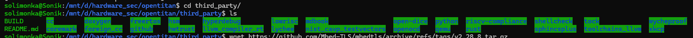

## Этап 2. Скачивание mbedTLS

**2)** `wget https://github.com/Mbed-TLS/mbedtls/archive/refs/tags/v2.28.8.tar.gz`

Скачиваем исходники mbedTLS версии 2.28.8.

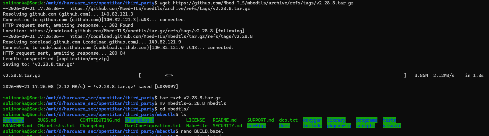

**3)** `tar -xzf v2.28.8.tar.gz; mv mbedtls-2.28.8 mbedtls; cd mbedtls`

Распаковываем архив и переименовываем каталог в mbedtls.


## Этап 3. Сборка mbedtls

**4)** `nano BUILD.bazel (плюс заглушки config.h, stdio.h, stdlib.h и baremetal_stubs.c)`

Пишем файл сборки и заглушки.

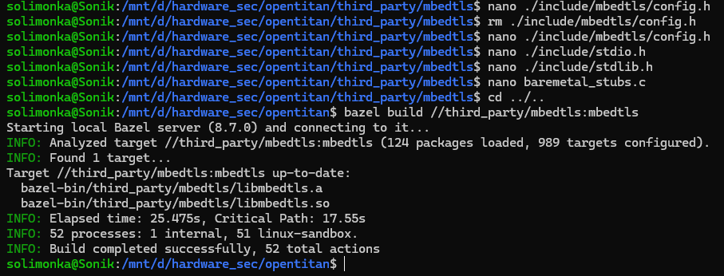

Файл: ~/opentitan/third_party/mbedtls/include/mbedtls/config.h

```
#ifndef MBEDTLS_CONFIG_H
#define MBEDTLS_CONFIG_H

/* Разрешаем подмену аппаратного источника энтропии своей функцией */
#define MBEDTLS_ENTROPY_HARDWARE_ALT

/* Bare-metal: никаких /dev/urandom, никакой стандартной библиотеки */
#define MBEDTLS_NO_PLATFORM_ENTROPY
#define MBEDTLS_PLATFORM_C
#define MBEDTLS_PLATFORM_NO_STD_FUNCTIONS
#define MBEDTLS_NO_DEFAULT_ENTROPY_SOURCES

/* Только нужные модули */
#define MBEDTLS_AES_C
#define MBEDTLS_CIPHER_C
#define MBEDTLS_CTR_DRBG_C
#define MBEDTLS_ENTROPY_C
#define MBEDTLS_SHA256_C
#define MBEDTLS_SHA224_C

/* Явно отключаем модули, завязанные на ОС */
#undef MBEDTLS_FS_IO
#undef MBEDTLS_NET_C
#undef MBEDTLS_TIMING_C
#undef MBEDTLS_THREADING_C

#include "mbedtls/check_config.h"
#endif
```

Файл: ~/opentitan/third_party/mbedtls/include/stdio.h

```
#ifndef MBEDTLS_STDIO_STUB
#define MBEDTLS_STDIO_STUB
#include <stddef.h>
typedef struct FILE FILE;
#define stdout ((FILE*)0)
#define stderr ((FILE*)0)
int fprintf(FILE *stream, const char *format, ...) { return 0; }
int printf(const char *format, ...) { return 0; }
int sprintf(char *str, const char *format, ...) { return 0; }
int snprintf(char *str, size_t size, const char *format, ...) { return 0; }
#endif
```

Файл: ~/opentitan/third_party/mbedtls/include/stdlib.h

```
#ifndef MBEDTLS_STDLIB_STUB
#define MBEDTLS_STDLIB_STUB
#include <stddef.h>
#define NULL ((void*)0)
void free(void *ptr) {}
void *malloc(size_t size) { return NULL; }
void *calloc(size_t nmemb, size_t size) { return NULL; }
void *realloc(void *ptr, size_t size) { return NULL; }
#endif
```

Файл: ~/opentitan/third_party/mbedtls/baremetal_stubs.c

```
#include <stddef.h>

// mbedTLS может требовать time()
unsigned long time(unsigned long *t) {
    if (t) *t = 0;
    return 0;
}

// Заглушка для gettimeofday
int gettimeofday(void *tv, void *tz) {
    return 0;
}

// Безопасная очистка памяти — единственная реально используемая функция
void mbedtls_platform_zeroize(void *buf, size_t len) {
    volatile unsigned char *p = (volatile unsigned char *)buf;
    while (len--) { *p++ = 0; }
}

void *mbedtls_calloc(size_t n, size_t size) { return NULL; }
void mbedtls_free(void *ptr) { (void)ptr; }
```

**5)** `bazel build //third_party/mbedtls`

Собираем библиотеку mbedtls. На выходе libmbedtls.a и libmbedtls.so.


## Этап 4. Пишем тест uart_crypto_service

**6)** `nano sw/device/tests/uart_crypto_service.c`

Пишем исходник собственного теста.

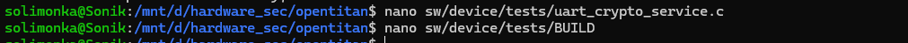

Файл: ~/opentitan/sw/device/tests/uart_crypto_service.c

```
#include "sw/device/lib/runtime/log.h"
#include "sw/device/lib/testing/test_framework/ottf_main.h"
#include "sw/device/lib/dif/dif_uart.h"
#include "sw/device/lib/base/mmio.h"
#include "hw/top_earlgrey/sw/autogen/top_earlgrey.h"

/* mbedTLS */
#include "mbedtls/entropy.h"
#include "mbedtls/ctr_drbg.h"
#include "mbedtls/aes.h"

OTTF_DEFINE_TEST_CONFIG();

static dif_uart_t uart;
static mbedtls_entropy_context entropy;
static mbedtls_ctr_drbg_context ctr_drbg;
static bool mbedtls_ready = false;

/* Собственная strlen — стандартная может быть недоступна */
static size_t my_strlen(const char *str) {
    size_t len = 0;
    while (str[len]) len++;
    return len;
}

/* Отправка байтового массива в HEX с паузами во избежание потерь */
void uart_send_hex(const uint8_t *data, size_t len) {
    const char hex[] = "0123456789ABCDEF";
    size_t sent;
    for (size_t i = 0; i < len; i++) {
        char buf[2] = {hex[data[i] >> 4], hex[data[i] & 0x0F]};
        CHECK_DIF_OK(dif_uart_bytes_send(&uart, (uint8_t *)buf, 2, &sent));
        /* Пауза каждые 8 байт — борьба с потерей данных в Verilator */
        if ((i + 1) % 8 == 0) {
            for (volatile int d = 0; d < 1000; d++) {}
        }
    }
}

/* Посимвольная отправка строки с задержкой */
void uart_send_string(const char *str) {
    size_t sent;
    size_t len = my_strlen(str);
    for (size_t i = 0; i < len; i++) {
        CHECK_DIF_OK(dif_uart_bytes_send(&uart, (uint8_t *)&str[i], 1, &sent));
        for (volatile int d = 0; d < 500; d++) {}
    }
}

/*
 * [2] Программный источник энтропии (fake entropy source)
 * Используется вместо аппаратного ENTROPY_SRC/CSRNG, так как в симуляции
 * Verilator их настройка требует значительных усилий и не обязательна
 * для демонстрации работы криптоподсистемы. В реальном железе OpenTitan
 * проблема решается штатными средствами — ENTROPY_SRC + CSRNG.
 */
int fake_entropy_source(void *data, unsigned char *output,
                        size_t len, size_t *olen) {
    static size_t counter = 0;
    for (size_t i = 0; i < len; i++) {
        output[i] = (unsigned char)((counter + i) * 0x9D ^ 0xA5);
    }
    counter++;
    *olen = len;
    return 0;
}

/* Инициализация mbedTLS с fallback-стратегией [1][2] */
bool init_mbedtls(void) {
    if (mbedtls_ready) return true;

    LOG_INFO("mbedTLS: initializing entropy and DRBG...");
    mbedtls_entropy_init(&entropy);

    /* Регистрируем программный источник энтропии — это и есть
       graceful degradation: если бы мы пытались использовать аппаратный RNG
       и он бы не инициализировался, мы бы точно так же подставили запасной
       программный вариант */
    mbedtls_entropy_add_source(&entropy, fake_entropy_source, NULL, 32,
                               MBEDTLS_ENTROPY_SOURCE_STRONG);

    mbedtls_ctr_drbg_init(&ctr_drbg);

    const char *pers = "OpenTitan_mbedTLS_Demo";
    int ret = mbedtls_ctr_drbg_seed(&ctr_drbg, mbedtls_entropy_func,
                                    &entropy,
                                    (unsigned char *)pers, my_strlen(pers));
    if (ret != 0) {
        LOG_ERROR("mbedTLS DRBG seed failed: %d", ret);
        return false;
    }

    mbedtls_ready = true;
    LOG_INFO("mbedTLS ready (using fake entropy for Verilator simulation)");
    return true;
}

/* Генерация ключа: mbedTLS, при отказе — детерминированный fallback [1] */
void generate_key(uint8_t *key, size_t len) {
    if (mbedtls_ready) {
        int ret = mbedtls_ctr_drbg_random(&ctr_drbg, key, len);
        if (ret == 0) return;
        LOG_ERROR("mbedTLS random failed: %d, using fallback", ret);
    }
    /* Аварийный fallback — отказало всё, генерируем хоть что-то */
    for (size_t i = 0; i < len; i++) {
        key[i] = (uint8_t)((i * 0x9D) ^ 0xA5);
    }
}

bool test_main(void) {
    /* Инициализация UART через DIF (Device Interface Functions) [1] */
    mmio_region_t uart_base =
        mmio_region_from_addr(TOP_EARLGREY_UART0_BASE_ADDR);
    CHECK_DIF_OK(dif_uart_init(uart_base, &uart));

    LOG_INFO("=== Crypto Service with mbedTLS ===");

    if (!init_mbedtls()) {
        LOG_ERROR("Failed to init mbedTLS — will use fallback generator");
    }

    /* Буфер для хранения текущего ключа AES-256 (32 байта) */
    uint8_t key[32];
    generate_key(key, 32);

    LOG_INFO("Service ready. Commands: 1=get key, 2=new key");

    /* Основной цикл обработки команд [1] */
    while (true) {
        uint8_t cmd;
        size_t recv;
        if (dif_uart_bytes_receive(&uart, 1, &cmd, &recv) == kDifOk && recv) {
            if (cmd == '1') {
                /* Выдача текущего ключа с маркером [AES256] для парсинга [1] */
                uart_send_string("[AES256]:");
                uart_send_hex(key, 32);
                uart_send_string("[OK]\r\n");
            } else if (cmd == '2') {
                /* Генерация нового ключа с маркером [KEY] */
                generate_key(key, 32);
                uart_send_string("[KEY]:");
                uart_send_hex(key, 32);
                uart_send_string("[OK]\r\n");
            }
        }
    }
    return true;
}
```

**7)** `nano sw/device/tests/BUILD`

Добавляем тест в систему сборки.


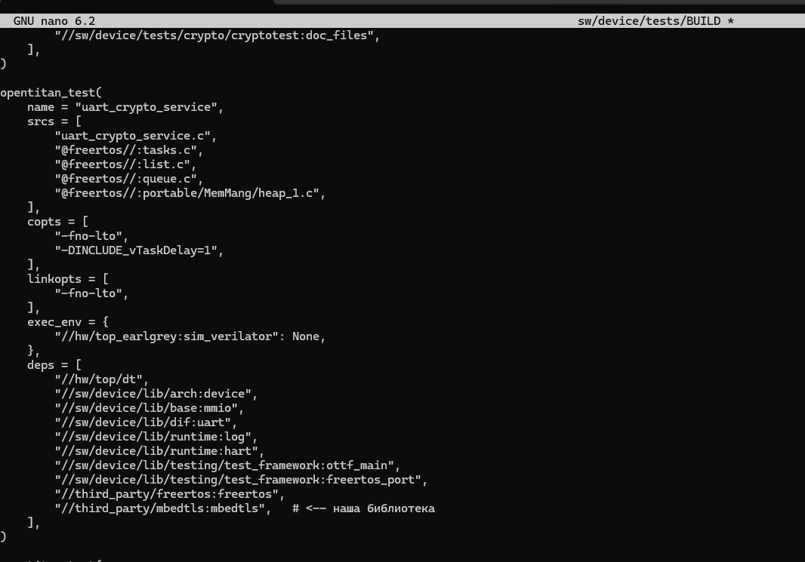

В BUILD указываем исходники, окружение sim_verilator и зависимости, включая mbedtls и FreeRTOS.

## Этап 5. Ошибка сборки

**8)** `bazel build //sw/device/tests:uart_crypto_service_sim_verilator`

Пробуем собрать тест.

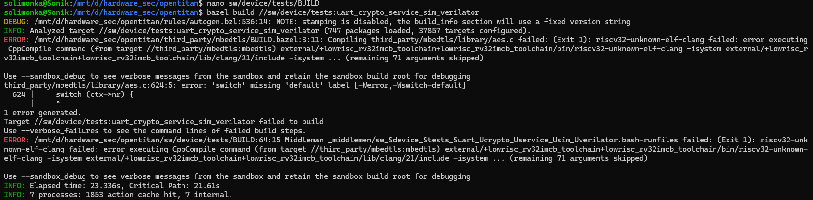

Сборка падает: в mbedtls/library/aes.c есть примерно такой код — switch без default:

```
switch (ctx->nr) {
    case 10: ... break;
    case 12: ... break;
    case 14: ... break;
}
```

Компилятор OpenTitan с флагом -Wswitch-default превращает это предупреждение в ошибку, и сборка не проходит.

## Этап 6. Исправление и повторная сборка

**9)** `nano third_party/mbedtls/BUILD.bazel`

В copts библиотеки добавляем -Wno-switch-default, чтобы отключить это предупреждение для mbedTLS.

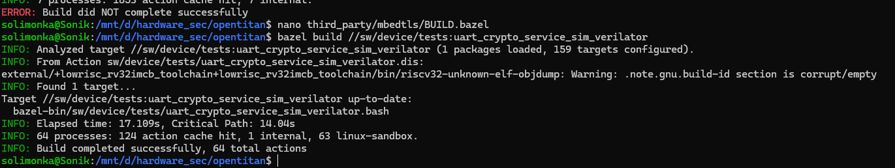

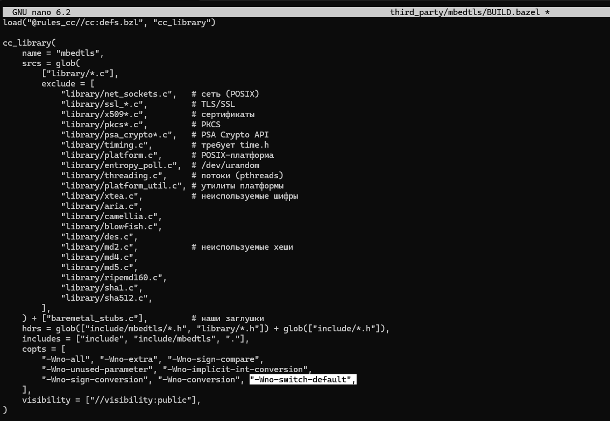

**10)** `bazel build //sw/device/tests:uart_crypto_service_sim_verilator`

Собираем ещё раз.


Теперь сборка проходит успешно.

## Этап 7. Запуск

**11)** `bazel run //sw/device/tests:uart_crypto_service_sim_verilator`

Запускаем тест на Verilator.

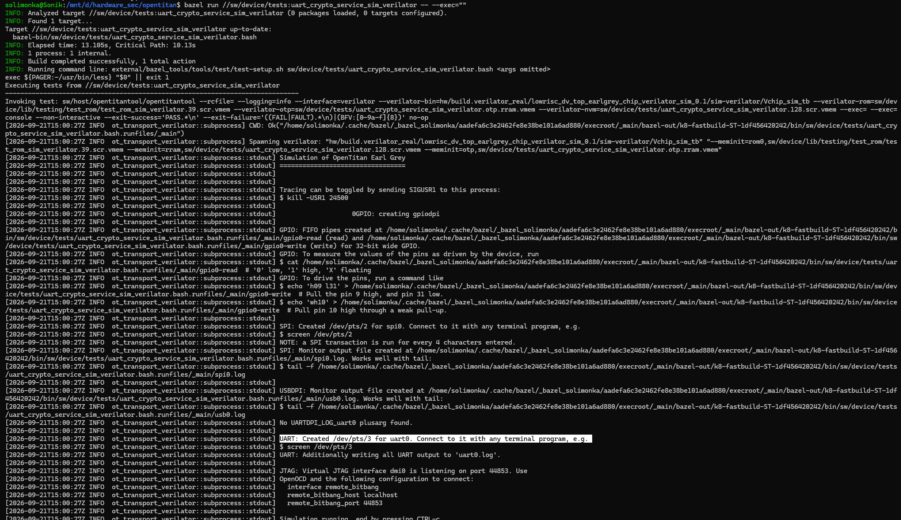

Поднимается симуляция и создаётся виртуальный последовательный порт — программа работает корректно.

## Этап 8. Написание клиентской части сервиса и его запуск

**12)** `nano uart_client.c; gcc -o uart_client uart_client.c`

Пишем хостовый клиент и компилируем его обычным gcc.

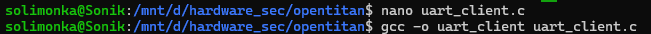

Клиент открывает виртуальный последовательный порт, ждёт сообщения о готовности сервиса, а затем отправляет команды: 1 — получить ключ, 2 — сгенерировать новый, q — выйти.

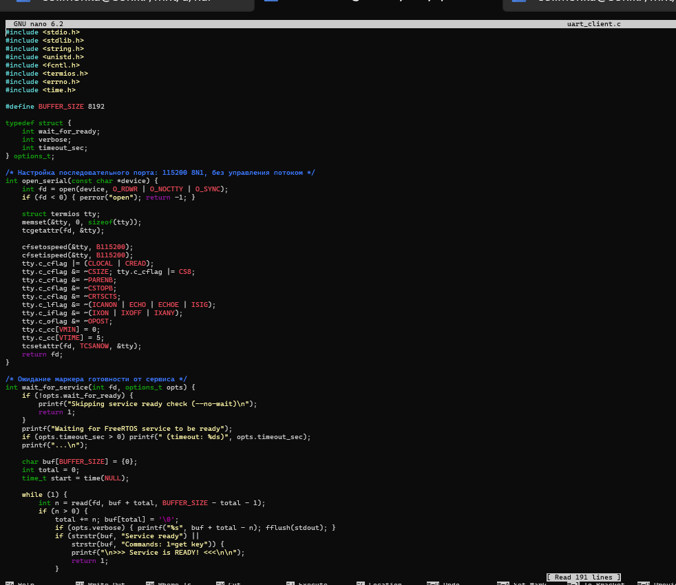

**13)** `bazel run //sw/device/tests:uart_crypto_service_sim_verilator`

Запускаем сервис на Verilator — поднимается симуляция и создаётся виртуальный UART-порт.

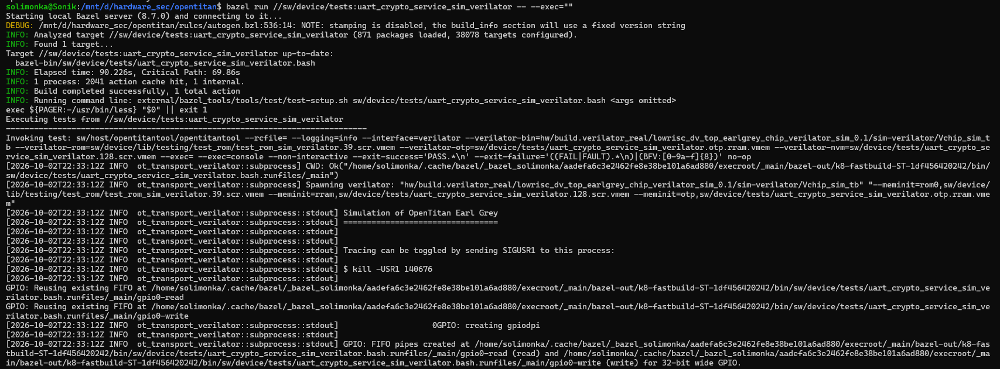

**В соседнем терминале**

**14)** `./uart_client /dev/pts/N`

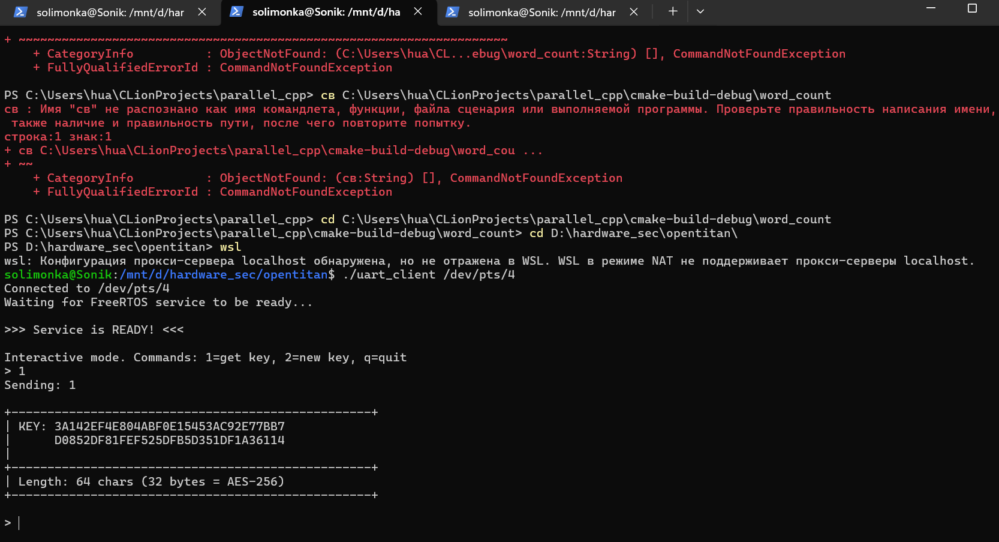

Клиент подключился к порту, дождался готовности сервиса и запросил ключ (команда 1) — в ответ пришёл AES-256 ключ (64 символа, 32 байта).

**Логи сервиса**

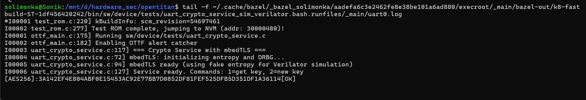

В логах видно, что сервис инициализировал mbedTLS, сообщил о готовности и ответил на запрос ключа.
