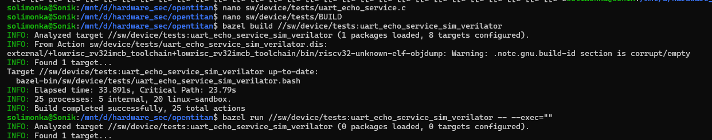
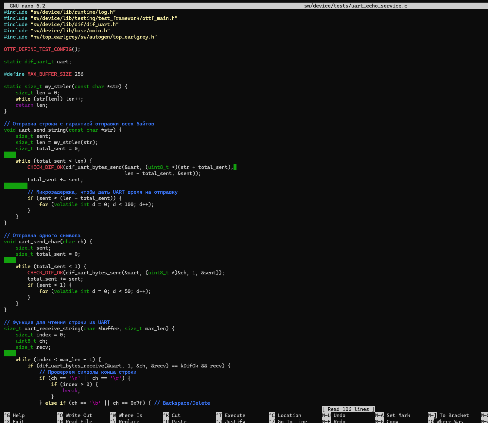
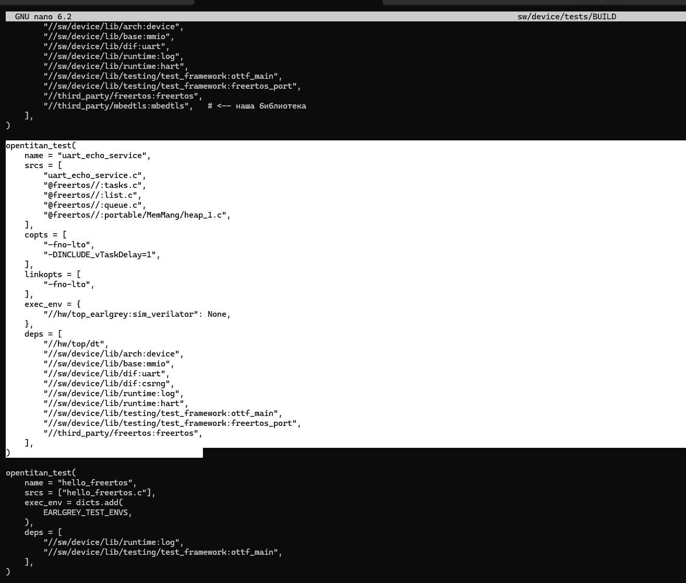
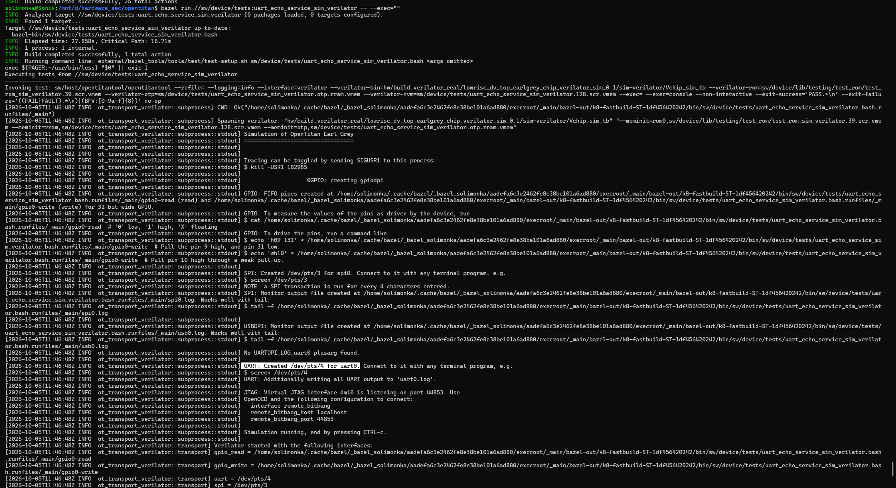
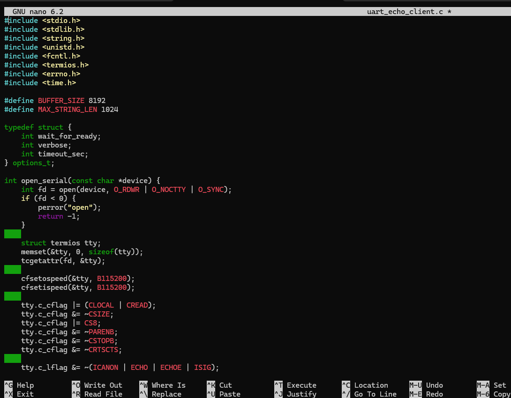
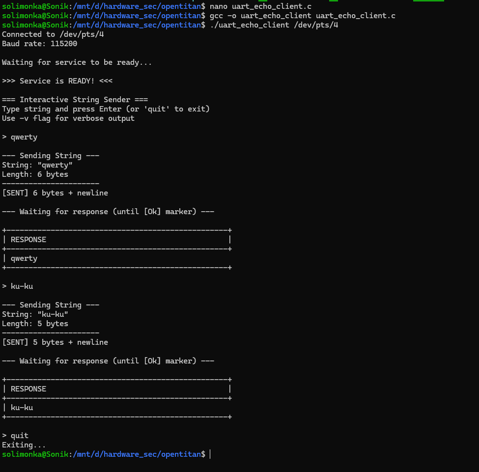

# ОПИСАНИЕ КОМАНД И ИХ РЕЗУЛЬТАТОВ

## Этап 1. Разработка эхо-сервиса (FreeRTOS)

**1)** `nano sw/device/tests/uart_echo_service.c`

Пишем встраиваемый сервис эхо-повтора.

Сервис в бесконечном цикле читает строку из UART и сразу отправляет её обратно.

**2)** `nano sw/device/tests/BUILD`

Добавляем цель uart_echo_service в систему сборки Bazel.

В BUILD указываем исходник, окружение и зависимости.

## Этап 2. Сборка и запуск

**3)** `bazel build //sw/device/tests:uart_echo_service_sim_verilator`

Собираем тест — сборка проходит успешно.

**4)** `bazel run //sw/device/tests:uart_echo_service_sim_verilator`

Запускаем сервис на Verilator.

## Этап 3. Разработка хост-клиента

**5)** `nano uart_client.c; gcc -o uart_client uart_client.c`

Пишем хостовый клиент и компилируем его обычным gcc.

Клиент отправляет строки и принимает эхо-ответы.

## Этап 4. Проверка эхо-повтора

**6)** `./uart_client /dev/pts/4`

Подключаемся к порту и отправляем тестовые строки.

Отправленные строки возвращаются обратно без изменений: "qwerty" → "qwerty", "ku-ku" → "ku-ku". Эхо-повтор работает корректно.
