# ОПИСАНИЕ КОМАНД И ИХ РЕЗУЛЬТАТОВ


CSRNG — это сокращение от Cryptographically Secure Random Number Generator, то есть «криптографически стойкий генератор случайных чисел». Это специальный аппаратный блок.

Как он работает:

1. В чипе есть источник энтропии ENTROPY_SRC. Энтропия — это «непредсказуемость», которая берётся из физических процессов (например, электрические шумы). Такие шумы никто не может предсказать заранее.

2. CSRNG берёт эту энтропию и «растягивает» её в поток случайных чисел по стандартной схеме DRBG (специальный алгоритм, описанный в стандарте).

У CSRNG есть несколько команд жизненного цикла как включить и выключить генератор: Instantiate — «включить и зарядить» генератор начальной энтропией; Generate — «выдать» случайное число; Reseed — «добавить» свежую энтропию; Uninstantiate — «выключить и стереть» внутреннее состояние, чтобы секреты не остались в памяти.

Чтобы программе было удобно общаться с этим блоком, в OpenTitan есть готовые функции, которые называются DIF (Device Interface Functions). Все они начинаются с dif_csrng... — именно они и общаются с CSRNG.

CHECK_DIF_OK(...) / CHECK_STATUS_OK(...) — проверка внутри теста, что команда прошла успешно, если функция вернула бы ошибку, тест сразу бы остановился.

LOG_INFO(...) — выводит сообщение.

## Этап 1. Базовый тест генерации случайного числа

**1)** `nano sw/device/tests/random_number.c`

Пишем тест, который инициализирует CSRNG и запрашивает одно 32-битное случайное число.

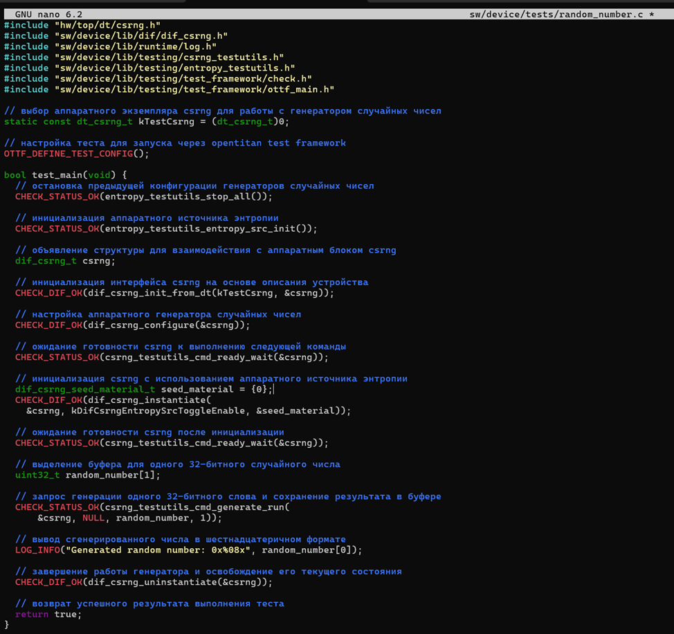

```
#include "hw/top/dt/csrng.h"
#include "sw/device/lib/dif/dif_csrng.h"
#include "sw/device/lib/runtime/log.h"
#include "sw/device/lib/testing/csrng_testutils.h"
#include "sw/device/lib/testing/entropy_testutils.h"
#include "sw/device/lib/testing/test_framework/check.h"
#include "sw/device/lib/testing/test_framework/ottf_main.h"

// выбор аппаратного экземпляра csrng для работы с генератором случайных чисел
static const dt_csrng_t kTestCsrng = (dt_csrng_t)0;

// настройка теста для запуска через opentitan test framework
OTTF_DEFINE_TEST_CONFIG();

bool test_main(void) {
  // остановка предыдущей конфигурации генераторов случайных чисел
  CHECK_STATUS_OK(entropy_testutils_stop_all());

  // инициализация аппаратного источника энтропии
  CHECK_STATUS_OK(entropy_testutils_entropy_src_init());

  // объявление структуры для взаимодействия с аппаратным блоком csrng
  dif_csrng_t csrng;

  // инициализация интерфейса csrng на основе описания устройства
  CHECK_DIF_OK(dif_csrng_init_from_dt(kTestCsrng, &csrng));

  // настройка аппаратного генератора случайных чисел
  CHECK_DIF_OK(dif_csrng_configure(&csrng));

  // ожидание готовности csrng к выполнению следующей команды
  CHECK_STATUS_OK(csrng_testutils_cmd_ready_wait(&csrng));

  // инициализация csrng с использованием аппаратного источника энтропии
  dif_csrng_seed_material_t seed_material = {0};
  CHECK_DIF_OK(dif_csrng_instantiate(
    &csrng, kDifCsrngEntropySrcToggleEnable, &seed_material));

  // ожидание готовности csrng после инициализации
  CHECK_STATUS_OK(csrng_testutils_cmd_ready_wait(&csrng));

  // выделение буфера для одного 32-битного случайного числа
  uint32_t random_number[1];

  // запрос генерации одного 32-битного слова и сохранение результата в буфере
  CHECK_STATUS_OK(csrng_testutils_cmd_generate_run(
      &csrng, NULL, random_number, 1));

  // вывод сгенерированного числа в шестнадцатеричном формате
  LOG_INFO("Generated random number: 0x%08x", random_number[0]);

  // завершение работы генератора и освобождение его текущего состояния
  CHECK_DIF_OK(dif_csrng_uninstantiate(&csrng));

  // возврат успешного результата выполнения теста
  return true;
}
```

**2)** `nano sw/device/tests/BUILD`

Добавляем цель random_number в систему сборки.

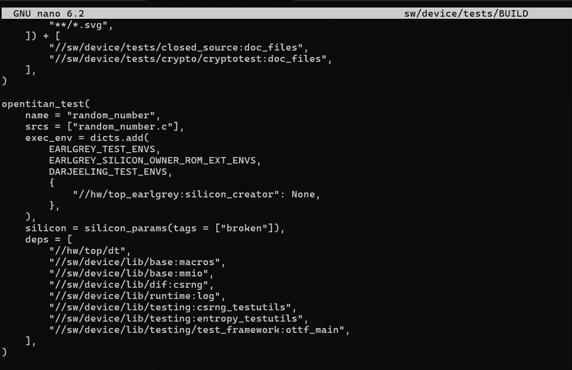

**3)** `./bazelisk.sh build //sw/device/tests:random_number`

Собираем тест.

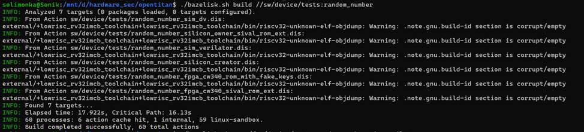

**4)** `./bazelisk.sh run //sw/device/tests:random_number_sim_verilator`

Запускаем тест на Verilator.

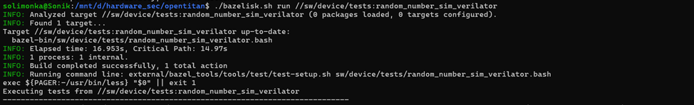

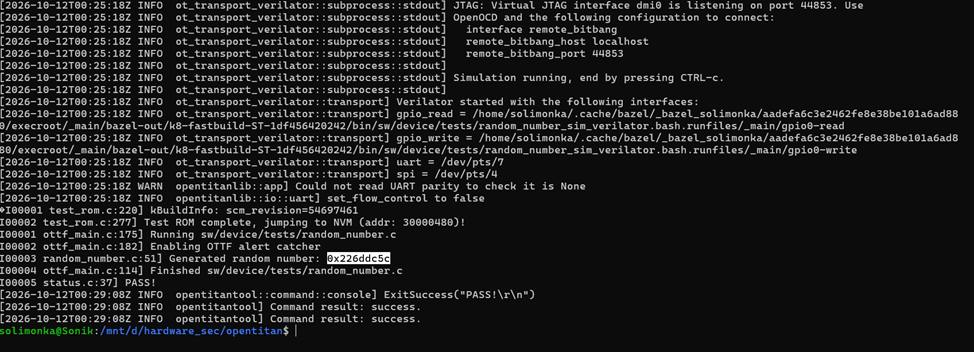

В логах видно, что тест прошёл (PASS) и сгенерированное число выведено в шестнадцатеричном формате.

## Этап 2. Сервис случайных чисел по запросу

**5)** `nano sw/device/tests/uart_random_number.c`

Пишем сервис, который принимает по UART десятичное число (1–1024) и возвращает запрошенное количество случайных байт в HEX.


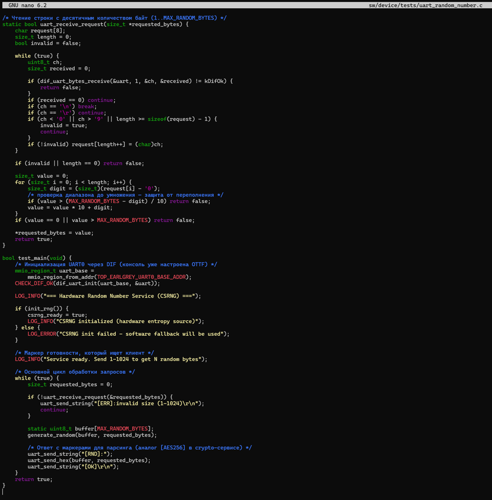

```
/*
 * Сервис случайных чисел.
 */

#include <stdbool.h>
#include <stddef.h>
#include <stdint.h>

#include "hw/top/dt/csrng.h"
#include "hw/top_earlgrey/sw/autogen/top_earlgrey.h"
#include "sw/device/lib/base/mmio.h"
#include "sw/device/lib/dif/dif_csrng.h"
#include "sw/device/lib/dif/dif_uart.h"
#include "sw/device/lib/runtime/log.h"
#include "sw/device/lib/testing/csrng_testutils.h"
#include "sw/device/lib/testing/entropy_testutils.h"
#include "sw/device/lib/testing/test_framework/check.h"
#include "sw/device/lib/testing/test_framework/ottf_main.h"

#define MAX_RANDOM_BYTES 1024
#define RANDOM_CHUNK_SIZE 16

OTTF_DEFINE_TEST_CONFIG();

static const dt_csrng_t kTestCsrng = (dt_csrng_t)0;

static dif_uart_t uart;
static dif_csrng_t csrng;
static bool csrng_ready = false;

static size_t my_strlen(const char *str) {
    size_t len = 0;
    while (str[len]) len++;
    return len;
}

/* Посимвольная отправка с ожиданием места в FIFO и паузами.
 * dif_uart_bytes_send() НЕ блокируется и при полном FIFO вернёт sent=0 —
 * поэтому повторяем, пока байт не будет принят (борьба с потерями в Verilator) */
static void uart_putc(char c) {
    size_t sent = 0;
    while (sent == 0) {
        CHECK_DIF_OK(dif_uart_bytes_send(&uart, (uint8_t *)&c, 1, &sent));
        for (volatile int d = 0; d < 500; d++) {}
    }
}

static void uart_send_string(const char *str) {
    for (size_t i = 0; i < my_strlen(str); i++) {
        uart_putc(str[i]);
    }
}

/* Отправка байтового массива в HEX с паузами во избежание потерь */
static void uart_send_hex(const uint8_t *data, size_t len) {
    static const char hex[] = "0123456789ABCDEF";
    for (size_t i = 0; i < len; i++) {
        uart_putc(hex[data[i] >> 4]);
        uart_putc(hex[data[i] & 0x0F]);
        /* Пауза каждые 8 байт — борьба с потерей данных в Verilator */
        if ((i + 1) % 8 == 0) {
            for (volatile int d = 0; d < 1000; d++) {}
        }
    }
}

/* Инициализация: как в csrng_smoketest, но без CHECK — при отказе уходим
 * на программный fallback, а не роняем сервис (graceful degradation) */
static bool init_rng(void) {
    /* остановка предыдущей конфигурации генераторов */
    if (!status_ok(entropy_testutils_stop_all())) return false;
    /* инициализация аппаратного источника энтропии */
    if (!status_ok(entropy_testutils_entropy_src_init())) return false;
    if (dif_csrng_init_from_dt(kTestCsrng, &csrng) != kDifOk) return false;
    if (dif_csrng_configure(&csrng) != kDifOk) return false;
    if (!status_ok(csrng_testutils_cmd_ready_wait(&csrng))) return false;

    dif_csrng_seed_material_t seed_material = {0};
    if (dif_csrng_instantiate(&csrng, kDifCsrngEntropySrcToggleEnable,
                              &seed_material) != kDifOk) return false;
    if (!status_ok(csrng_testutils_cmd_ready_wait(&csrng))) return false;
    return true;
}

/* Генерация одного блока (до 16 байт) через CSRNG */
static bool csrng_generate_chunk(uint32_t *words, size_t words_count) {
    if (!status_ok(csrng_testutils_cmd_ready_wait(&csrng))) return false;
    if (dif_csrng_generate_start(&csrng, NULL, words_count) != kDifOk) return false;
    if (!status_ok(csrng_testutils_cmd_generate_run(&csrng, NULL, words,
                                                    words_count))) return false;
    return true;
}

/* Аварийный fallback — детерминированный программный генератор */
static void software_generate(uint8_t *buf, size_t len) {
    static uint32_t counter = 0;
    for (size_t i = 0; i < len; i++) {
        buf[i] = (uint8_t)((i * 0x9D) ^ 0xA5 ^ (counter * 0x1B));
    }
    counter++;
}

/* Однократное предупреждение о переходе на fallback */
static void warn_fallback(void) {
    static bool warned = false;
    if (!warned) {
        LOG_ERROR("CSRNG unavailable - using deterministic software fallback");
        warned = true;
    }
}

/* Генерация len байт; при отказе CSRNG — fallback (ответ клиенту уйти должен) */
static void generate_random(uint8_t *buf, size_t len) {
    if (csrng_ready) {
        uint32_t words_buf[RANDOM_CHUNK_SIZE / sizeof(uint32_t)];
        bool ok = true;

        for (size_t off = 0; ok && off < len; off += RANDOM_CHUNK_SIZE) {
            size_t n = (len - off < RANDOM_CHUNK_SIZE) ? (len - off)
                                                       : RANDOM_CHUNK_SIZE;
            size_t words = (n + sizeof(uint32_t) - 1) / sizeof(uint32_t);

            ok = csrng_generate_chunk(words_buf, words);
            if (ok) {
                for (size_t i = 0; i < n; i++) {
                    buf[off + i] =
                        (uint8_t)(words_buf[i / sizeof(uint32_t)] >>
                                  ((i % sizeof(uint32_t)) * 8));
                }
            }
        }
        if (ok) return;
        csrng_ready = false; /* аппаратура отказала — дальше только fallback */
    }
    warn_fallback();
    software_generate(buf, len);
}

/* Чтение строки с десятичным количеством байт (1..MAX_RANDOM_BYTES) */
static bool uart_receive_request(size_t *requested_bytes) {
    char request[8];
    size_t length = 0;
    bool invalid = false;

    while (true) {
        uint8_t ch;
        size_t received = 0;

        if (dif_uart_bytes_receive(&uart, 1, &ch, &received) != kDifOk) {
            return false;
        }
        if (received == 0) continue;
        if (ch == '\n') break;
        if (ch == '\r') continue;
        if (ch < '0' || ch > '9' || length >= sizeof(request) - 1) {
            invalid = true;
            continue;
        }
        if (!invalid) request[length++] = (char)ch;
    }

    if (invalid || length == 0) return false;

    size_t value = 0;
    for (size_t i = 0; i < length; i++) {
        size_t digit = (size_t)(request[i] - '0');
        /* проверка диапазона до умножения — защита от переполнения */
        if (value > (MAX_RANDOM_BYTES - digit) / 10) return false;
        value = value * 10 + digit;
    }
    if (value == 0 || value > MAX_RANDOM_BYTES) return false;

    *requested_bytes = value;
    return true;
}

bool test_main(void) {
    /* Инициализация UART0 через DIF (консоль уже настроена OTTF) */
    mmio_region_t uart_base =
        mmio_region_from_addr(TOP_EARLGREY_UART0_BASE_ADDR);
    CHECK_DIF_OK(dif_uart_init(uart_base, &uart));

    LOG_INFO("=== Hardware Random Number Service (CSRNG) ===");

    if (init_rng()) {
        csrng_ready = true;
        LOG_INFO("CSRNG initialized (hardware entropy source)");
    } else {
        LOG_ERROR("CSRNG init failed - software fallback will be used");
    }

    /* Маркер готовности, который ищет клиент */
    LOG_INFO("Service ready. Send 1-1024 to get N random bytes");

    /* Основной цикл обработки запросов */
    while (true) {
        size_t requested_bytes = 0;

        if (!uart_receive_request(&requested_bytes)) {
            uart_send_string("[ERR]:invalid size (1-1024)\r\n");
            continue;
        }

        static uint8_t buffer[MAX_RANDOM_BYTES];
        generate_random(buffer, requested_bytes);

        /* Ответ с маркерами для парсинга (аналог [AES256] в crypto-сервисе) */
        uart_send_string("[RND]:");
        uart_send_hex(buffer, requested_bytes);
        uart_send_string("[OK]\r\n");
    }
    return true;
}
```

**6)** `nano sw/device/tests/BUILD`

Добавляем цель uart_random_number в систему сборки.

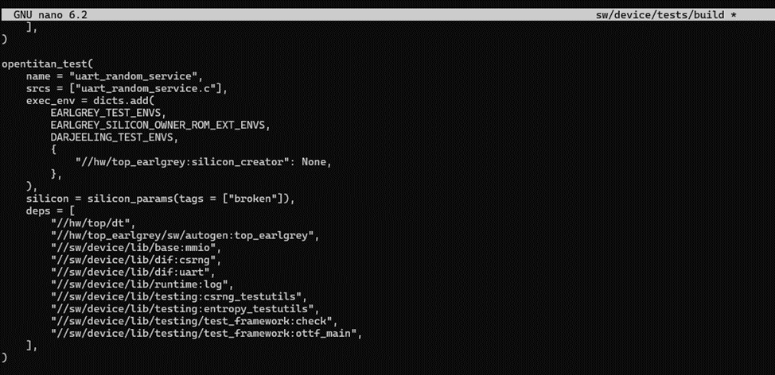

**7)** `./bazelisk.sh build //sw/device/tests:uart_random_number`

Собираем сервис.

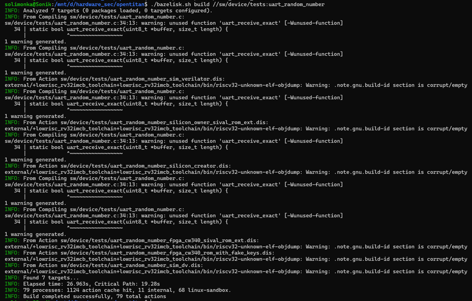

**8)** `./bazelisk.sh run //sw/device/tests:uart_random_number_sim_verilator`

Запускаем сервис на Verilator — поднимается симуляция и создаётся виртуальный UART-порт.

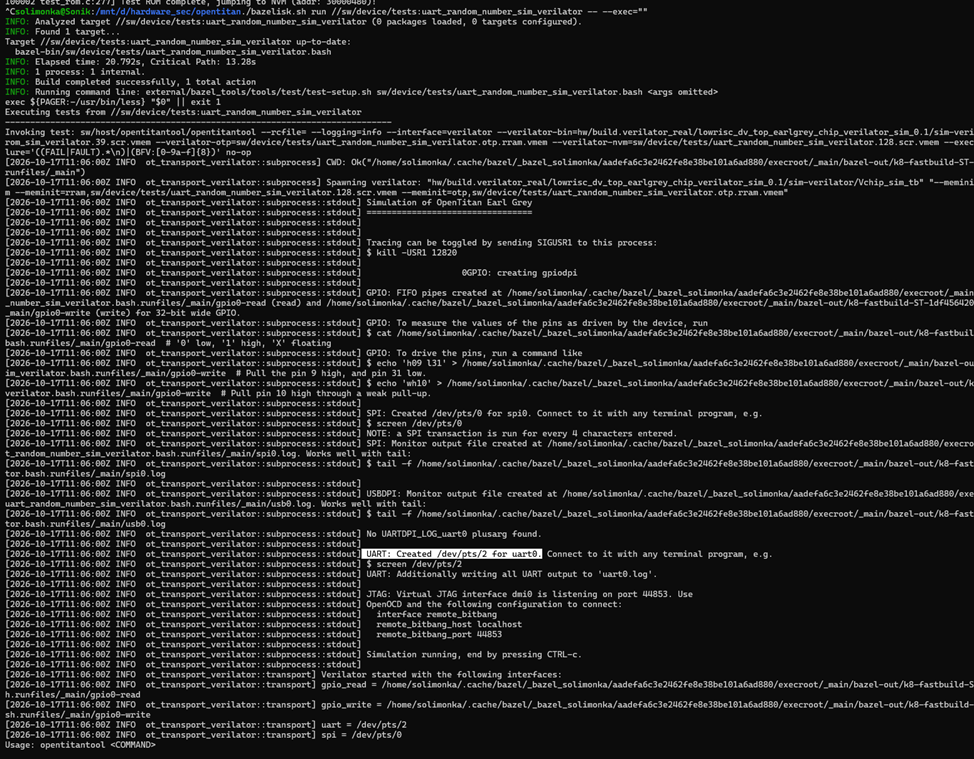

В логах видно, что сервис инициализировал CSRNG с аппаратным источником энтропии и готов принимать запросы.

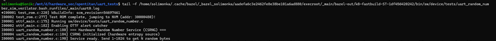

## Этап 3. Энтропия в реальном чипе и в Verilator

**Энтропия в реальном чипе**

ENTROPY_SRC собирает физическую энтропию — непредсказуемые шумы (кольцевые генераторы, тепловой/электрический шум).

CSRNG берёт эту энтропию и «растягивает» её в поток случайных чисел по схеме DRBG (стандарт SP 800-90A, по сути CTR_DRBG).

**Энтропия в Verilator**

Verilator — это симулятор/эмулятор на уровне RTL: никаких аналоговых шумов и физики там нет. Поэтому реальный физический источник энтропии заменяется программной моделью:

Модуль entropy_src_esrng (в hw/ip/entropy_src/rtl/) — «ES RNG», заглушка, эмулирующая шумящий источник. Внутри это LFSR-подобный псевдослучайный генератор, который выдаёт биты как будто шум.

entropy_src_core собирает/смешивает эти биты и отдаёт их дальше как сырьё для CSRNG.

То есть в симуляции цепочка та же: es_rng → entropy_src_core → CSRNG (DRBG) → регистры, но на входе вместо настоящего шума — детерминированный LFSR.

LFSR (Linear Feedback Shift Register — регистр сдвига с линейной обратной связью) — это цифровое устройство (сдвиговый регистр), у которого входной бит является линейной булевой функцией (обычно операцией XOR / сложение по модулю 2) от его предыдущего состояния.

**Откуда берётся сама «случайность»**

Ключевой момент: в Verilator случайность псевдослучайная и детерминированная. LFSR-генератор (entropy_src_esrng) стартует с некоторого seed (начальное состояние). Seed задаётся при запуске симуляции — обычно через плюсарг/конфигурацию тестбенча (например, +entropy_src_seed=...) или через $urandom в тестбенче.

При одном и том же seed последовательность случайных чисел одинаковая от запуска к запуску. Поменяв seed, получаем другую последовательность.

Настоящей непредсказуемости в Verilator нет, поэтому это удобно для воспроизводимости тестов.

**Программная сторона (DIF-функции)**

Сам тест (sw/device/tests/random_number.c) общается с блоками через Device Interface Functions:

dif_entropy_src_... — настройка/включение источника энтропии;

dif_csrng_instantiate(...), dif_csrng_generate(...), dif_csrng_reseed(...), dif_csrng_uninstantiate(...) — команды жизненного цикла CSRNG, соответствующие Instantiate/Generate/Reseed/Uninstantiate из документа.

Эти функции не генерируют случайность сами, а они пишут/читают регистры CSRNG. А сами числа в симуляции рождаются из LFSR-заглушки entropy_src_esrng, засеянной seed'ом.

## Этап 4. Отличие от программного fallback в uart_crypto_service.c

В заглушках из установленных криптобиблиотек есть uart_crypto_service.c:

```
/*
 * [2] Программный источник энтропии (fake entropy source)
 * Используется вместо аппаратного ENTROPY_SRC/CSRNG, так как в симуляции
 * Verilator их настройка требует значительных усилий и не обязательна
 * для демонстрации работы криптоподсистемы. В реальном железе OpenTitan
 * проблема решается штатными средствами — ENTROPY_SRC + CSRNG.
 */
```

Программный источник энтропии (fake entropy source). Используется вместо аппаратного ENTROPY_SRC/CSRNG, так как в симуляции Verilator их настройка требует значительных усилий и т.д. Там регистрируется fake_entropy_source() — детерминированный генератор:

`output[i] = (unsigned char)((counter + i) * 0x9D ^ 0xAB);`

## Этап 5. Написание клиентской части сервиса и его запуск

**9)** `nano uart_random_number_client.c; gcc -o uart_random_number_client uart_random_number_client.c`

Пишем хостовый клиент.

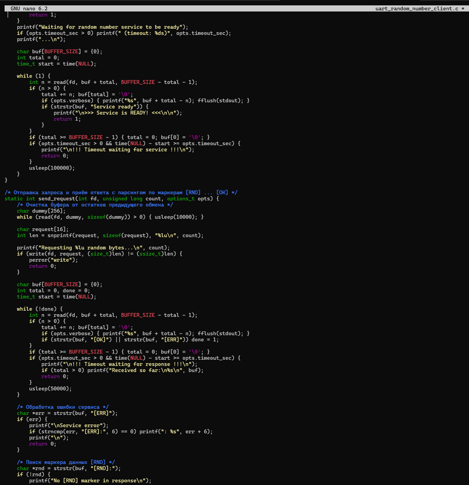

Клиент открывает виртуальный последовательный порт, ждёт сообщения о готовности сервиса, а затем отправляет запросы: число от 1 до 1024 — получить столько случайных байт, q — выйти. Поддерживаются также режимы одного запроса (аргумент count) и подробного вывода трафика (`-v`).

```
/*
 * Клиент сервиса случайных чисел (по образцу uart_client.c).
 *
 *   ./uart_random_number_client /dev/pts/8        — интерактивный режим
 *   ./uart_random_number_client /dev/pts/8 64     — один запрос 64 байт
 *   ./uart_random_number_client -v /dev/pts/8     — показать весь трафик
 */

#include <errno.h>
#include <fcntl.h>
#include <stdio.h>
#include <stdlib.h>
#include <string.h>
#include <termios.h>
#include <time.h>
#include <unistd.h>

#define BUFFER_SIZE      8192
#define MAX_RANDOM_BYTES 1024

typedef struct {
    int wait_for_ready;
    int verbose;
    int timeout_sec;
} options_t;

/* Настройка последовательного порта: 115200 8N1, без управления потоком */
static int open_serial(const char *device) {
    int fd = open(device, O_RDWR | O_NOCTTY | O_SYNC);
    if (fd < 0) {
        if (errno == EBUSY) {
            fprintf(stderr,
                "ERROR: %s is busy - probably held by the opentitantool "
                "console.\n"
                "Start the simulation with --exec=\"\":\n"
                "  ./bazelisk.sh run //sw/device/tests:uart_random_number_sim_verilator -- --exec=\"\"\n"
                "and connect to the /dev/pts/N from the line "
                "'UART: Created /dev/pts/N for uart0'.\n", device);
        } else {
            perror("open");
        }
        return -1;
    }

    struct termios tty;
    memset(&tty, 0, sizeof(tty));
    tcgetattr(fd, &tty);

    cfsetospeed(&tty, B115200);
    cfsetispeed(&tty, B115200);
    tty.c_cflag |= (CLOCAL | CREAD);
    tty.c_cflag &= ~CSIZE; tty.c_cflag |= CS8;
    tty.c_cflag &= ~PARENB;
    tty.c_cflag &= ~CSTOPB;
    tty.c_cflag &= ~CRTSCTS;
    tty.c_lflag &= ~(ICANON | ECHO | ECHOE | ISIG);
    tty.c_iflag &= ~(IXON | IXOFF | IXANY);
    tty.c_oflag &= ~OPOST;
    tty.c_cc[VMIN] = 0;
    tty.c_cc[VTIME] = 5;
    tcsetattr(fd, TCSANOW, &tty);
    tcflush(fd, TCIOFLUSH);
    return fd;
}

/* Ожидание маркера готовности от сервиса */
static int wait_for_service(int fd, options_t opts) {
    if (!opts.wait_for_ready) {
        printf("Skipping service ready check (--no-wait)\n");
        return 1;
    }
    printf("Waiting for random number service to be ready");
    if (opts.timeout_sec > 0) printf(" (timeout: %ds)", opts.timeout_sec);
    printf("...\n");

    char buf[BUFFER_SIZE] = {0};
    int total = 0;
    time_t start = time(NULL);

    while (1) {
        int n = read(fd, buf + total, BUFFER_SIZE - total - 1);
        if (n > 0) {
            total += n; buf[total] = '\0';
            if (opts.verbose) { printf("%s", buf + total - n); fflush(stdout); }
            if (strstr(buf, "Service ready")) {
                printf("\n>>> Service is READY! <<<\n\n");
                return 1;
            }
        }
        if (total >= BUFFER_SIZE - 1) { total = 0; buf[0] = '\0'; }
        if (opts.timeout_sec > 0 && time(NULL) - start >= opts.timeout_sec) {
            printf("\n!!! Timeout waiting for service !!!\n");
            return 0;
        }
        usleep(100000);
    }
}

/* Отправка запроса и приём ответа с парсингом по маркерам [RND] ... [OK] */
static int send_request(int fd, unsigned long count, options_t opts) {
    /* Очистка буфера от остатков предыдущего обмена */
    char dummy[256];
    while (read(fd, dummy, sizeof(dummy)) > 0) { usleep(10000); }

    char request[16];
    int len = snprintf(request, sizeof(request), "%lu\n", count);

    printf("Requesting %lu random bytes...\n", count);
    if (write(fd, request, (size_t)len) != (ssize_t)len) {
        perror("write");
        return 0;
    }

    char buf[BUFFER_SIZE] = {0};
    int total = 0, done = 0;
    time_t start = time(NULL);

    while (!done) {
        int n = read(fd, buf + total, BUFFER_SIZE - total - 1);
        if (n > 0) {
            total += n; buf[total] = '\0';
            if (opts.verbose) { printf("%s", buf + total - n); fflush(stdout); }
            if (strstr(buf, "[OK]") || strstr(buf, "[ERR]")) done = 1;
        }
        if (total >= BUFFER_SIZE - 1) { total = 0; buf[0] = '\0'; }
        if (opts.timeout_sec > 0 && time(NULL) - start >= opts.timeout_sec) {
            printf("\n!!! Timeout waiting for response !!!\n");
            if (total > 0) printf("Received so far:\n%s\n", buf);
            return 0;
        }
        usleep(50000);
    }

    /* Обработка ошибки сервиса */
    char *err = strstr(buf, "[ERR]");
    if (err) {
        printf("\nService error");
        if (strncmp(err, "[ERR]:", 6) == 0) printf(": %s", err + 6);
        printf("\n");
        return 0;
    }

    /* Поиск маркера данных [RND] */
    char *rnd = strstr(buf, "[RND]:");
    if (!rnd) {
        printf("No [RND] marker in response\n");
        if (opts.verbose) printf("Full response:\n%s\n", buf);
        return 0;
    }
    rnd += 6;

    printf("\n+--------------------------------------------------+\n");
    printf("| RANDOM BYTES:\n| ");
    int chars = 0;
    while (*rnd &&
           ((*rnd >= '0' && *rnd <= '9') ||
            (*rnd >= 'A' && *rnd <= 'F') ||
            (*rnd >= 'a' && *rnd <= 'f'))) {
        putchar(*rnd);
        rnd++;
        chars++;
        if (chars % 32 == 0) printf("\n| ");
    }
    printf("\n+--------------------------------------------------+\n");
    printf("| Length: %d chars (%d bytes)\n", chars, chars / 2);
    printf("+--------------------------------------------------+\n\n");

    if (chars / 2 != (int)count) {
        printf("WARNING: expected %lu bytes, got %d (data may be lost)\n",
               count, chars / 2);
        return 0;
    }
    return 1;
}

static void print_usage(const char *prog) {
    printf("Usage: %s [OPTIONS] /dev/pts/N [count]\n", prog);
    printf("\nOPTIONS:\n");
    printf("  --no-wait       Don't wait for service ready message\n");
    printf("  --wait          Wait for ready (default)\n");
    printf("  --timeout N     Wait timeout in seconds (0=infinite)\n");
    printf("  -v, --verbose   Show all UART output\n");
    printf("  -h, --help      This help\n");
    printf("\nCOUNT:\n");
    printf("  1..%d          Number of random bytes to request\n",
           MAX_RANDOM_BYTES);
    printf("  (no count)     Interactive mode, q=quit\n");
    printf("\nNOTE: start the simulation with --exec=\"\" so opentitantool\n"
           "does not occupy the UART pty.\n");
}

int main(int argc, char *argv[]) {
    options_t opts = { .wait_for_ready = 1, .verbose = 0, .timeout_sec = 0 };
    char *device = NULL;
    long count_arg = -1;

    for (int i = 1; i < argc; i++) {
        if (strcmp(argv[i], "--no-wait") == 0) opts.wait_for_ready = 0;
        else if (strcmp(argv[i], "--wait") == 0) opts.wait_for_ready = 1;
        else if (strcmp(argv[i], "--timeout") == 0 && i + 1 < argc)
            opts.timeout_sec = atoi(argv[++i]);
        else if (strcmp(argv[i], "-v") == 0 || strcmp(argv[i], "--verbose") == 0)
            opts.verbose = 1;
        else if (strcmp(argv[i], "-h") == 0 || strcmp(argv[i], "--help") == 0)
            { print_usage(argv[0]); return 0; }
        else if (argv[i][0] == '/') device = argv[i];
        else {
            char *end = NULL;
            errno = 0;
            long v = strtol(argv[i], &end, 10);
            if (errno == 0 && end != argv[i] && *end == '\0' &&
                v >= 1 && v <= MAX_RANDOM_BYTES) {
                count_arg = v;
            } else {
                printf("ERROR: bad argument: %s\n\n", argv[i]);
                print_usage(argv[0]);
                return 1;
            }
        }
    }

    if (!device) {
        printf("ERROR: No device specified\n\n");
        print_usage(argv[0]);
        return 1;
    }

    int fd = open_serial(device);
    if (fd < 0) return 1;
    printf("Connected to %s\n", device);
    if (opts.verbose) printf("Verbose mode ON\n\n");

    if (!wait_for_service(fd, opts)) { close(fd); return 1; }

    if (count_arg > 0) {
        send_request(fd, (unsigned long)count_arg, opts);
    } else {
        printf("Interactive mode. Enter 1..%d to get random bytes, q=quit\n",
               MAX_RANDOM_BYTES);
        char line[64];
        while (1) {
            printf("> ");
            fflush(stdout);
            if (!fgets(line, sizeof(line), stdin)) break;
            if (line[0] == 'q' || line[0] == 'Q') break;

            char *end = NULL;
            errno = 0;
            long v = strtol(line, &end, 10);
            while (end && (*end == ' ' || *end == '\t' ||
                           *end == '\r' || *end == '\n')) end++;
            if (errno != 0 || end == line || *end != '\0' ||
                v < 1 || v > MAX_RANDOM_BYTES) {
                printf("Enter a number from 1 to %d (or q to quit)\n",
                       MAX_RANDOM_BYTES);
                continue;
            }
            send_request(fd, (unsigned long)v, opts);
        }
    }

    close(fd);
    return 0;
}
```

Компилируем клиент обычным gcc.


**10)** `./bazelisk.sh run //sw/device/tests:uart_random_number_sim_verilator -- --exec=""`

Запускаем сервис на Verilator. Важно передать `--exec=""`, чтобы opentitantool не занимал виртуальный UART-порт — иначе клиент не сможет к нему подключиться (ошибка EBUSY). Поднимается симуляция и создаётся виртуальный UART-порт вида `/dev/pts/N`.

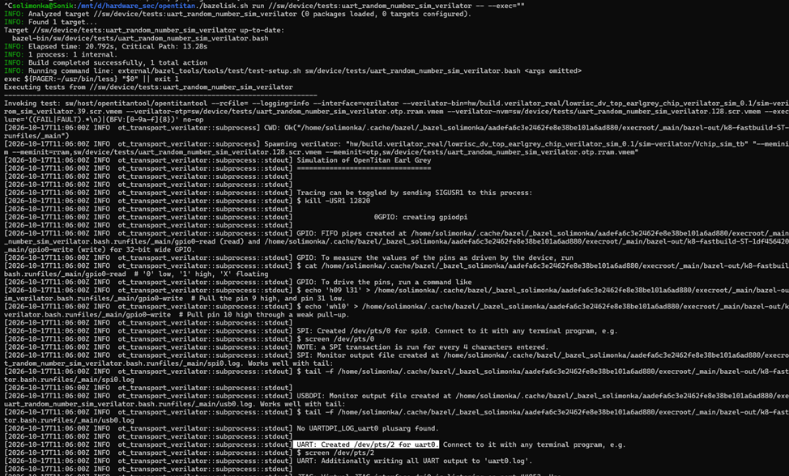

**В соседнем терминале**

**11)** `./uart_random_number_client /dev/pts/N`

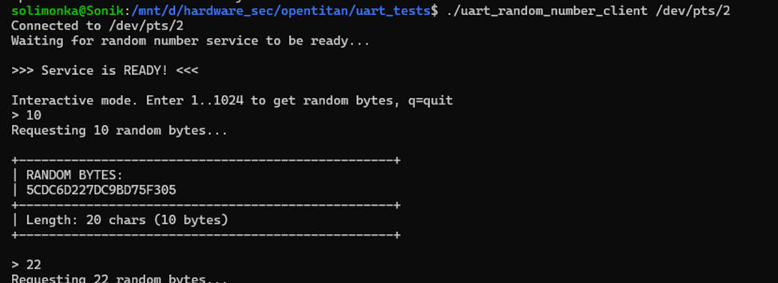

Клиент подключился к порту, дождался готовности сервиса и запросил случайные байты — в ответ пришли запрашиваемые случайные байты.

**Логи сервиса**

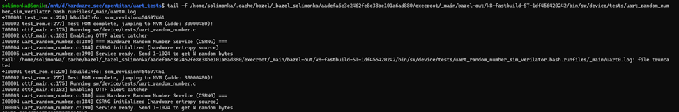

В логах видно, что сервис инициализировал CSRNG с аппаратным источником энтропии, сообщил о готовности и ответил на запросы клиента. При отказе CSRNG сервис не падает, а переходит на детерминированный программный fallback (graceful degradation) и продолжает обслуживать запросы.
