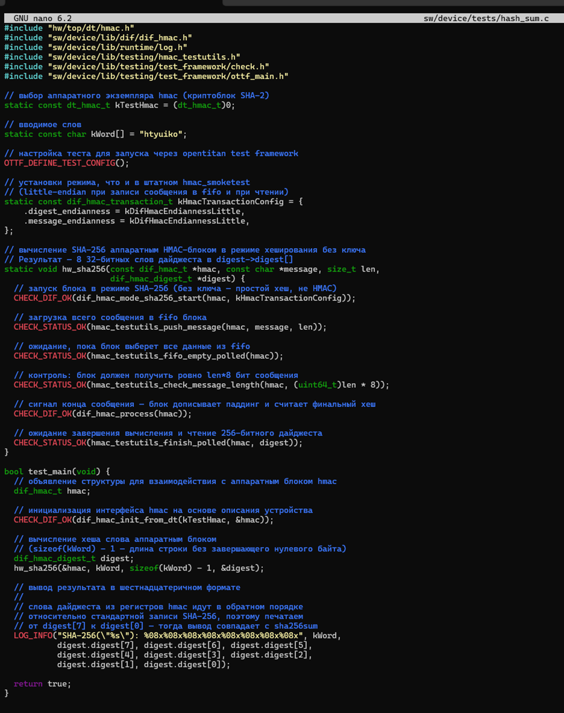
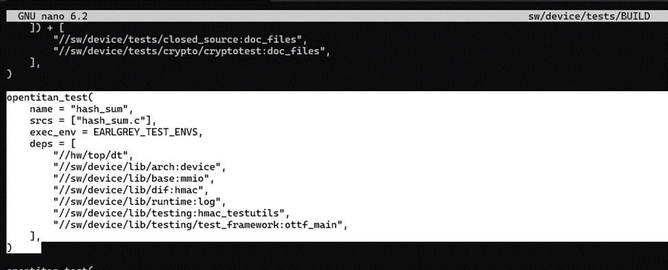
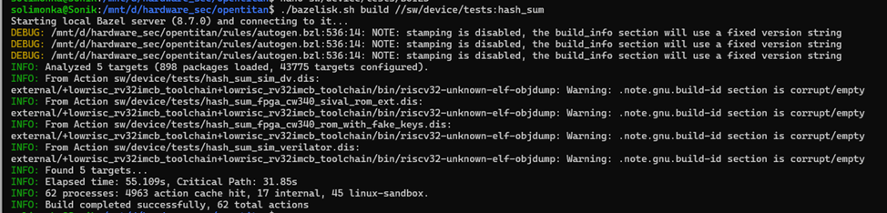
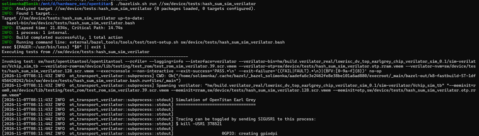
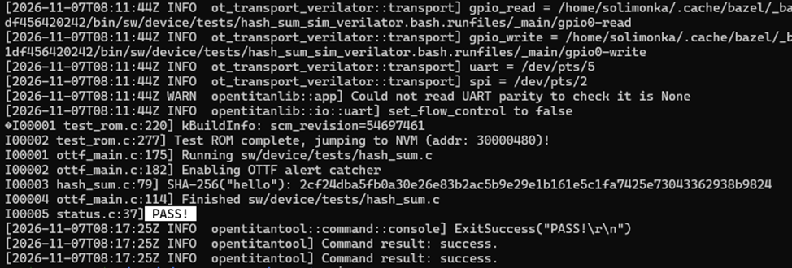
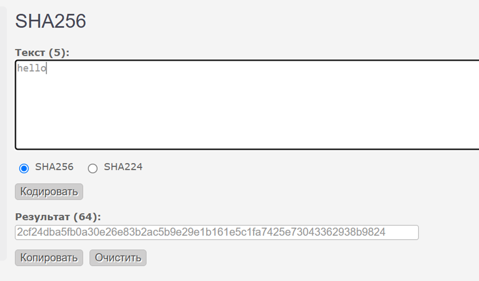
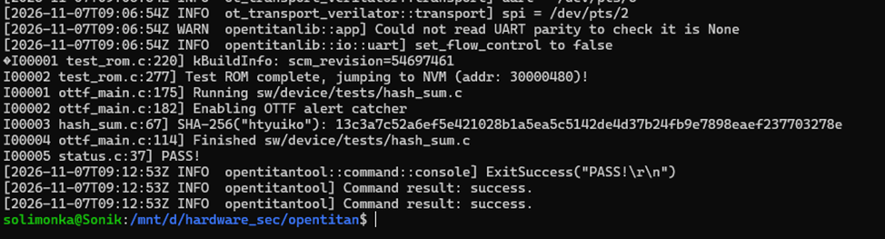
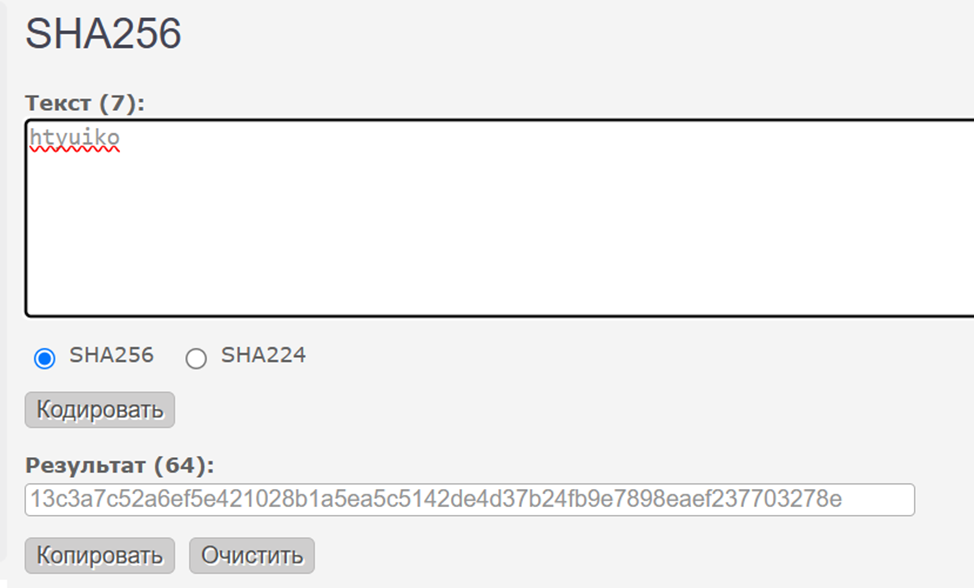

# ОПИСАНИЕ КОМАНД И ИХ РЕЗУЛЬТАТОВ

SHA-256 — это криптографическая хеш-функция, которая на входе принимает сообщение произвольной длины, а на выходе даёт 256-битный «отпечаток» (дайджест). Одно и то же сообщение всегда даёт один и тот же хеш, а из хеша практически невозможно восстановить исходное сообщение. SHA-256 широко применяется для проверки целостности данных, в цифровых подписях и в построении других криптографических конструкций (HMAC, DRBG и т.д.).

В OpenTitan за вычисление SHA-2 отвечает аппаратный блок HMAC. Несмотря на название, HMAC — это не только хеширование с ключом: тот же блок умеет работать в режиме обычного хеширования без ключа (plain SHA-256 / SHA-224). Именно этот режим и используется в нашем тесте.

Как работает аппаратный хеш-блок:

1. Программа записывает байты сообщения во входной FIFO (очередь) блока — по 4 байта (32 бита) за раз.

2. Блок забирает данные из FIFO и прогоняет их через ядро SHA-256. Внутри — регистры состояния (8 32-битных слов) и раундовая функция, которая на каждом шаге перемешивает данные с константами по алгоритму SHA-256.

3. Когда программа сигнализирует о конце сообщения (команда Process), блок сам дописывает стандартный паддинг (единичный бит, нули и длину сообщения в битах) и вычисляет финальный хеш.

4. Готовый 256-битный дайджест (8 слов) программа читает из выходного FIFO.

Преимущество аппаратной реализации — скорость и изоляция: хеш считается в отдельном блоке, не занимая CPU, а ключи и промежуточные данные при желании можно не выпускать наружу.

Чтобы программе было удобно общаться с блоком, в OpenTitan есть готовые функции — DIF (Device Interface Functions). Все они начинаются с `dif_hmac...` — именно они настраивают блок и пишут/читают его регистры.

`CHECK_DIF_OK(...)` / `CHECK_STATUS_OK(...)` — проверка внутри теста, что команда прошла успешно; если функция вернула бы ошибку, тест сразу бы остановился.

`LOG_INFO(...)` — выводит сообщение в консоль (UART).

## Этап 1. Разработка теста аппаратного SHA-256

**1)** `nano sw/device/tests/hash_sum.c`

Пишем тест, который вычисляет SHA-256 от строки с помощью аппаратного блока HMAC в режиме хеширования без ключа. Результат — 8 32-битных слов дайджеста, которые выводятся в шестнадцатеричном формате.



Слова дайджеста в регистрах HMAC идут в обратном порядке относительно стандартной записи SHA-256, поэтому при печати они переставляются от `digest[7]` к `digest[0]` — так вывод совпадает с `sha256sum`.

```
solimonka@Sonik:/mnt/d/hardware_sec/opentitan$ cat sw/device/tests/hash_sum.c
#include "hw/top/dt/hmac.h"
#include "sw/device/lib/dif/dif_hmac.h"
#include "sw/device/lib/runtime/log.h"
#include "sw/device/lib/testing/hmac_testutils.h"
#include "sw/device/lib/testing/test_framework/check.h"
#include "sw/device/lib/testing/test_framework/ottf_main.h"

// выбор аппаратного экземпляра hmac (криптоблок SHA-2)
static const dt_hmac_t kTestHmac = (dt_hmac_t)0;

// вводимое слов
static const char kWord[] = "htyuiko";

// настройка теста для запуска через opentitan test framework
OTTF_DEFINE_TEST_CONFIG();

// установки режима, что и в штатном hmac_smoketest
// (little-endian при записи сообщения в fifo и при чтении)
static const dif_hmac_transaction_t kHmacTransactionConfig = {
    .digest_endianness = kDifHmacEndiannessLittle,
    .message_endianness = kDifHmacEndiannessLittle,
};

// вычисление SHA-256 аппаратным HMAC-блоком в режиме хеширования без ключа
// Результат — 8 32-битных слов дайджеста в digest->digest[]
static void hw_sha256(const dif_hmac_t *hmac, const char *message, size_t len,
                      dif_hmac_digest_t *digest) {
  // запуск блока в режиме SHA-256 (без ключа — простой хеш, не HMAC)
  CHECK_DIF_OK(dif_hmac_mode_sha256_start(hmac, kHmacTransactionConfig));

  // загрузка всего сообщения в fifo блока
  CHECK_STATUS_OK(hmac_testutils_push_message(hmac, message, len));

  // ожидание, пока блок выберет все данные из fifo
  CHECK_STATUS_OK(hmac_testutils_fifo_empty_polled(hmac));

  // контроль: блок должен получить ровно len*8 бит сообщения
  CHECK_STATUS_OK(hmac_testutils_check_message_length(hmac, (uint64_t)len * 8));

  // сигнал конца сообщения — блок дописывает паддинг и считает финальный хеш
  CHECK_DIF_OK(dif_hmac_process(hmac));

  // ожидание завершения вычисления и чтение 256-битного дайджеста
  CHECK_STATUS_OK(hmac_testutils_finish_polled(hmac, digest));
}

bool test_main(void) {
  // объявление структуры для взаимодействия с аппаратным блоком hmac
  dif_hmac_t hmac;

  // инициализация интерфейса hmac на основе описания устройства
  CHECK_DIF_OK(dif_hmac_init_from_dt(kTestHmac, &hmac));

  // вычисление хеша слова аппаратным блоком
  // (sizeof(kWord) - 1 — длина строки без завершающего нулевого байта)
  dif_hmac_digest_t digest;
  hw_sha256(&hmac, kWord, sizeof(kWord) - 1, &digest);

  // вывод результата в шестнадцатеричном формате
  //
  // слова дайджеста из регистров hmac идут в обратном порядке
  // относительно стандартной записи SHA-256, поэтому печатаем
  // от digest[7] к digest[0] — тогда вывод совпадает с sha256sum
  LOG_INFO("SHA-256(\"%s\"): %08x%08x%08x%08x%08x%08x%08x%08x", kWord,
           digest.digest[7], digest.digest[6], digest.digest[5],
           digest.digest[4], digest.digest[3], digest.digest[2],
           digest.digest[1], digest.digest[0]);

  return true;
}
```

**2)** `nano sw/device/tests/BUILD`

Добавляем тест hash_sum в систему сборки Bazel.



## Этап 2. Сборка и запуск теста

**3)** `./bazelisk.sh build //sw/device/tests:hash_sum`

Собираем тест — сборка проходит успешно.



**4)** `./bazelisk.sh run //sw/device/tests:hash_sum_sim_verilator`

Запускаем тест на Verilator. Поднимается симуляция, тест выполняется и выводит вычисленный хеш.



В логах видно, что тест прошёл PASS и для строки получен хеш:

`13c3a7c52a6ef5e421028b1a5ea5c5142de4d37b24fb9e7898eaef237703278e`



## Этап 3. Проверка результата через онлайн-сервис

**5)** Для контроля открываем онлайн-калькулятор SHA-256 и вводим строку.



Полученный результат `13c3a7c52a6ef5e421028b1a5ea5c5142de4d37b24fb9e7898eaef237703278e` полностью совпадает с тем, что вычислил аппаратный блок OpenTitan.

Проверяем теперь работу с другой строкой:





Таким образом, аппаратный HMAC-блок корректно реализует SHA-256: хеш, посчитанный на чипе, побитово совпадает с эталонным значением.