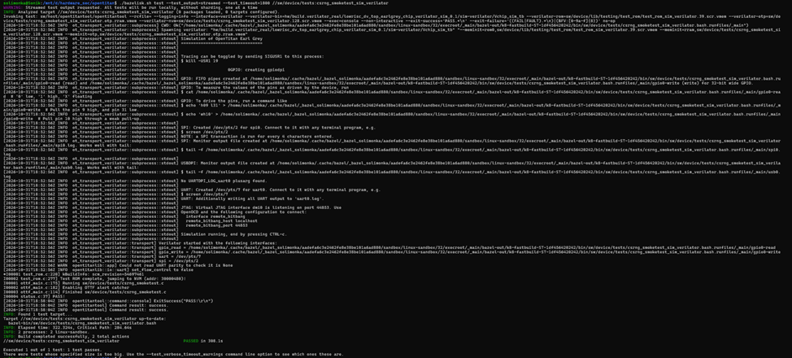
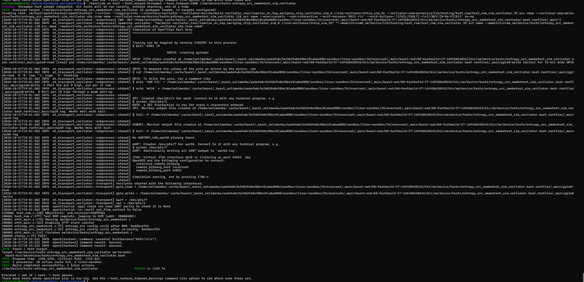
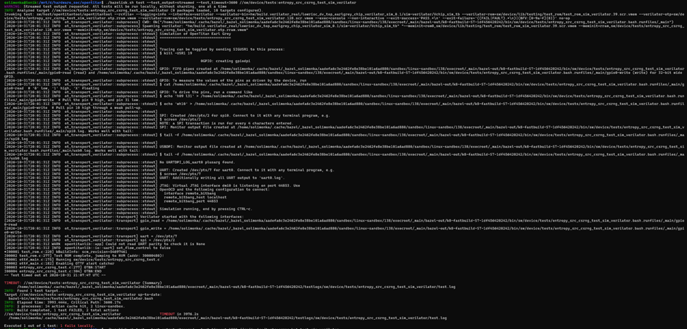
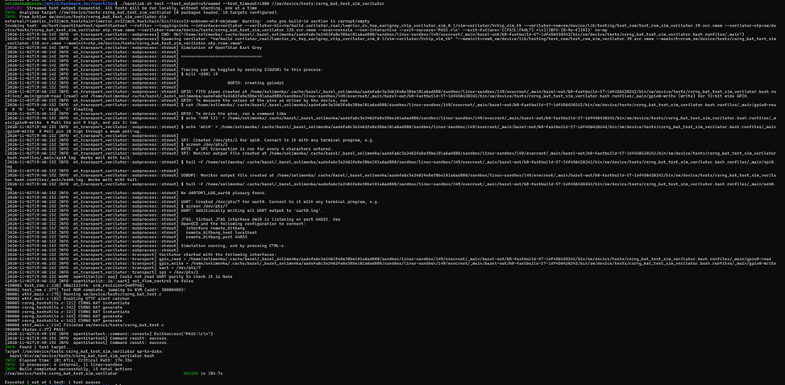
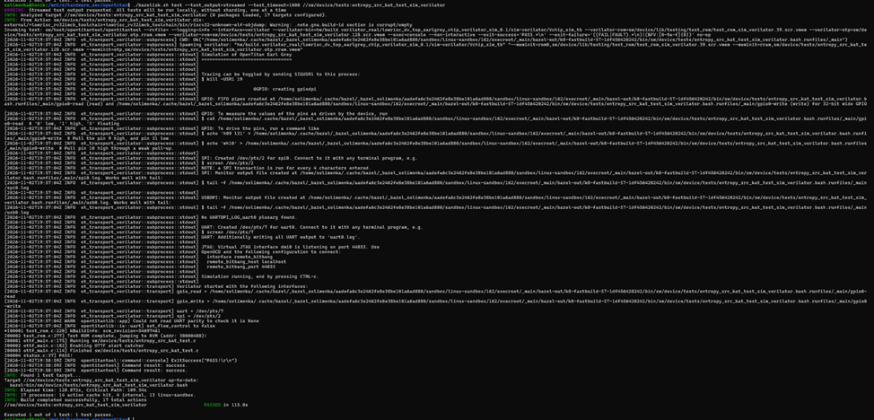

# ОПИСАНИЕ КОМАНД И ИХ РЕЗУЛЬТАТОВ

## Этап 1. Смоук-тест CSRNG

**1)** `./bazelisk.sh test --test_output=streamed --test_timeout=1800 //sw/device/tests:csrng_smoketest_sim_verilator`

Запускаем смоук-тест генератора CSRNG. Тест проверяет, что аппаратный CSRNG корректно реализует CTR_DRBG (AES-256, вариант «no DF») в сокращённом виде: uninstantiate → instantiate с фиксированным EntropyInput из официального вектора NIST CAVP (384 бита) → две команды Generate по 512 бит, после чего выходные биты побитово сравниваются с эталоном NIST (при несовпадении — «Generate command KAT output mismatch»). По исходнику это «упрощённая версия csrng_kat_test»: из проверок исключено чтение внутреннего состояния (reseed_counter) ради скорости выполнения.

Тест проходит успешно — CSRNG корректно реализует алгоритм CTR_DRBG.

## Этап 2. Смоук-тест источника энтропии

**2)** `./bazelisk.sh test --test_output=streamed --test_timeout=1800 //sw/device/tests:entropy_src_smoketest_sim_verilator`

Запускаем смоук-тест источника энтропии. Проверяется работоспособность полного тракта entropy_src: от сырого шума через health-тесты и кондиционер SHA3 до выдачи данных прошивке. Тест переконфигурирует entropy_src в FIPS-режиме (route_to_firmware=true, кондиционер включён, окно health-тестов 2048 бит, alert_threshold=2), дожидается, что основная FSM войдёт в состояние непрерывных health-тестов (ContHTRunning), собирает 10 32-битных слов через FIFO, проверяет отсутствие повторов соседних слов («Received duplicate entropy, this should never happen») и нулевое значение регистра ошибок в конце.

Особенность: единственный из смоук-тестов, работающий на реальном источнике шума (в Verilator — LFSR-модель), поэтому он недетерминирован и самый медленный — десятки минут на симуляции являются нормой; печатает CRC32 конфигурации после ROM и после переконфигурации (значение используется для контроля OTP-конфигурации).

Тест проходит успешно — источник энтропии выдаёт данные без повторов и ошибок.

## Этап 3. Тест цепочки entropy_src → csrng

**3)** `./bazelisk.sh test --test_output=streamed --test_timeout=3600 //sw/device/tests:entropy_src_csrng_test_sim_verilator`

Запускаем тест совместной работы блоков цепочки генерации через PLIC-прерывания в двух фазах. Фаза 1: программный инстанс CSRNG — при командах Instantiate/Reseed от entropy_src должно приходить прерывание cs_entropy_req. Фаза 2: EDN0/EDN1 конфигурируются через SW_CMD_REQ с контролем прерываний edn_cmd_req_done, после чего OTBN-программа пять раз читает регистр RND — проверяется доставка энтропии до периферийного потребителя (entropy_src → CSRNG → EDN → OTBN).

Во втором прогоне OTBN:END печатается примерно на 25–28-й минуте, дальше у прошивки было ещё полчаса тишины — ни одной новой строки. А следующая по коду строка — DONE.

По исходнику теста между OTBN:END и DONE лежат только два irq_block_wait(): тест в бесконечном цикле ATOMIC_WAIT_FOR_INTERRUPT (без таймаута) ждёт финальных прерываний edn_cmd_req_done от EDN0/EDN1. Они не приходят — тест стоит вечно.

Это то место, которое авторы пометили в исходнике как хрупкое: если EDN1 не доисполнит Generate ровно до конца — «causing a hang in the irq_block_wait() calls following the end of the OTBN test». Тест вручную раздаёт EDN-команды впритык под потребность OTBN (5 чтений RND × 256 бит = 10 блоков по 128 бит), и на симуляторных таймингах прерывания и счётчик команд расходятся.

## Этап 4. KAT — сверка математики DRBG с эталонными векторами NIST

Это два KAT — Known Answer Test («тест известных ответов»): прошивка подаёт в блок фиксированный эталонный вход из официальных векторов NIST и сверяет выход побитово. 

**4)** `./bazelisk.sh test --test_output=streamed --test_timeout=1800 //sw/device/tests:csrng_kat_test_sim_verilator`

Запускаем KAT для CSRNG. Проверяется, что аппаратный CSRNG действительно корректно реализует CTR_DRBG (AES-256, вариант «no DF») — команды Instantiate и Generate дают ровно те выходные биты, что зафиксированы в официальных векторах NIST CAVP.

Особенность: entropy_src здесь отключён (Instantiate с kDifCsrngEntropySrcToggleDisable) — в качестве seed прошивка записывает фиксированный EntropyInput.

Тест проходит успешно — математика DRBG совпадает с эталоном NIST.

**5)** `./bazelisk.sh test --test_output=streamed --test_timeout=1800 //sw/device/tests:entropy_src_kat_test_sim_verilator`

Запускаем KAT для entropy_src. Проверяется, что entropy_src — аппаратный SHA3-384, который в реальной цепочке превращает сырой шум (в чипе — от аналогового источника, в Verilator — LFSR) в набор для CSRNG. KAT доказывает, что этот тракт считает SHA3-384 побитово правильно.

Ключевая особенность: реальный источник шума в тесте не участвует вообще — entropy_src включается в firmware override mode. Прошивка сама записывает известное сообщение, значит тест детерминирован и от LFSR-заглушки Verilator не зависит.

Тест проходит успешно — считает побитово правильно.

