Работа выполнена в wsl на ubuntu 22.04

В ходе выполнения мы столкнулись с нехваткой ресурсов, поэтому перед началом работы рекомендуем выделить достаточно ресурсов. Для этого нужно создать файл .wslconfig с описанием какие ресурсы нужно выделить.

Оптимальный вариан, который мы прописали в нашем файле:

```
[wsl2]
memory=14GB
processors=12
swap=14GB
```

Также обращаем ваше внимание, что FreeRTOS уже заранее установлена в OpenTitan и ничего скачивать дополнительно не нужно.

## Этап 1. Клонирование репозитория OpenTitan

**1)** `git clone https://github.com/lowRISC/opentitan.git`

Клонируем репозиторий OpenTitan.

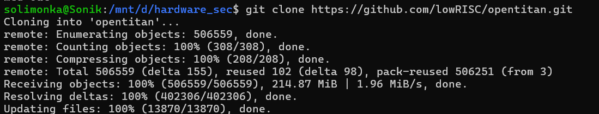

**2)** `export REPO_TOP=$PWD/opentitan`

Записываем путь к репозиторию в переменную REPO_TOP, чтобы дальше ссылаться на него коротко.

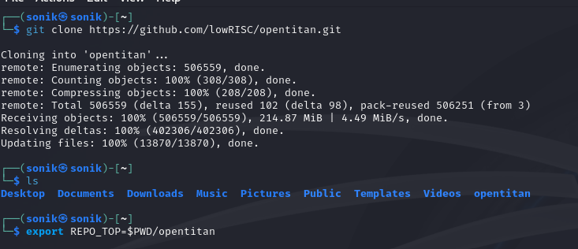

## Этап 2. Установка системных зависимостей

**3)** `sed '/^#/d' ./apt-requirements.txt | xargs sudo apt install -y`

Ставим все нужные пакеты из apt-requirements.txt.

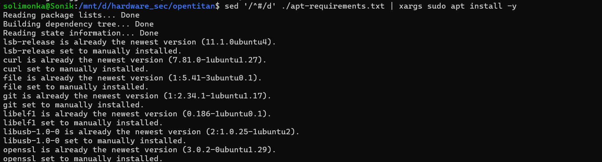

## Этап 3. Настройка виртуального окружения Python

**4)** `sudo apt install python3-venv`

Ставим модуль venv, чтобы изолировать Python-зависимости OpenTitan.

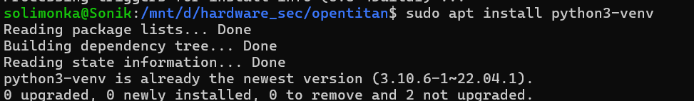

**5)** `cd $REPO_TOP`

Заходим в корень репозитория.

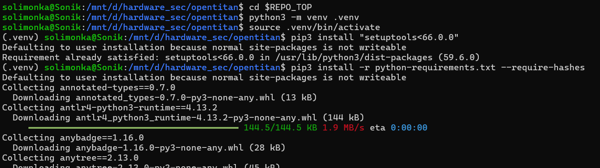

**6)** `python3 -m venv .venv`

Создаём виртуальное окружение в папке .venv.


**7)** `source .venv/bin/activate`

Активируем окружение.


**8)** `pip3 install "setuptools<66.0.0"`

Ставим подходящую версию setuptools (новые OpenTitan не подходят). Уже стояла 59.6.0.


**9)** `pip3 install -r python-requirements.txt --require-hashes`

Ставим все Python-зависимости из списка с проверкой хешей.


## Этап 4. Сборка и установка Verilator

**10)** `git clone https://github.com/verilator/verilator.git`

Клонируем Verilator — им будем симулировать чип.

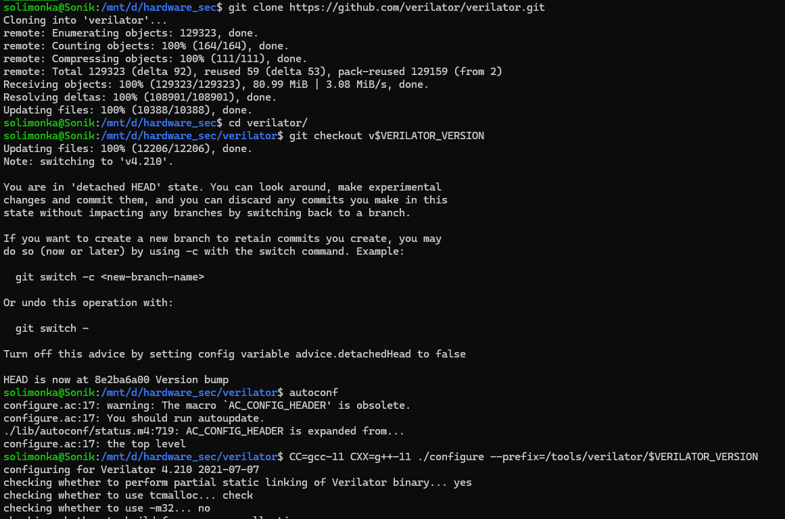

**11)** `cd verilator; git checkout v$VERILATOR_VERSION`

Переключаемся на версию 4.210, которую требует OpenTitan.


**12)** `autoconf`

Запускаем скрипт сборки конфига.


**13)** `CC=gcc-11 CXX=g++-11 ./configure --prefix=/tools/verilator/4.210`

Настраиваем сборку; явно задаём gcc-11/g++-11, потому что с GCC 12+ Verilator 4.210 не собирается.


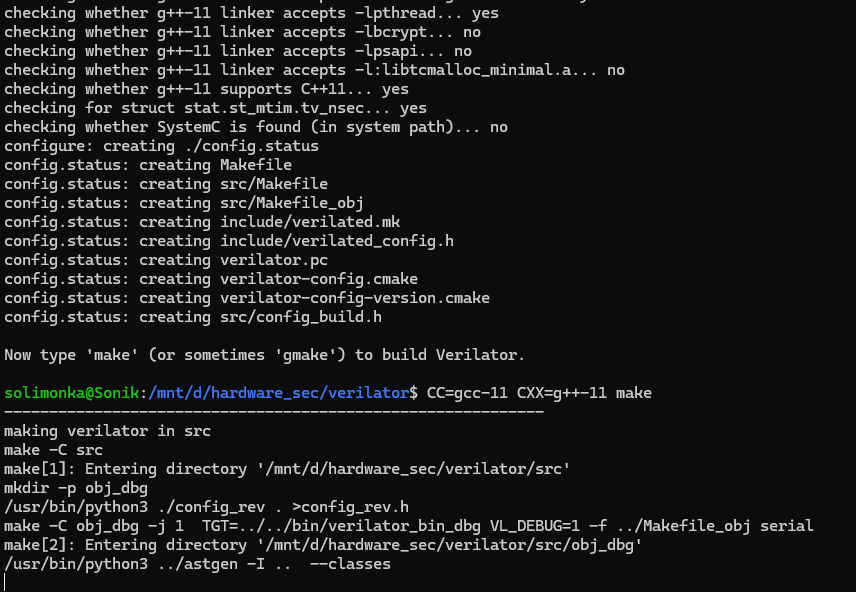

**14)** `CC=gcc-11 CXX=g++-11 make`

Компилируем Verilator.


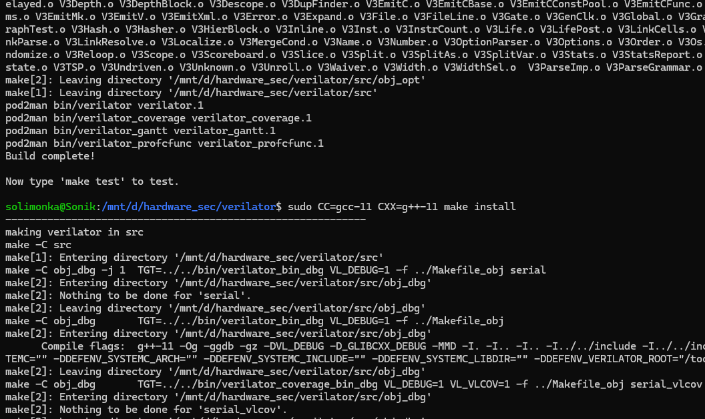

**15)** `sudo CC=gcc-11 CXX=g++-11 make install`

Устанавливаем собранный Verilator.


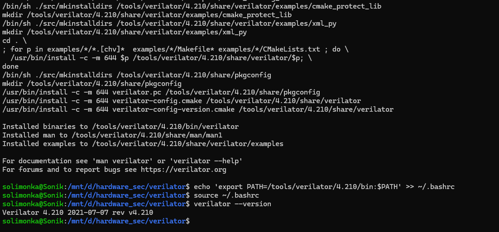

**16)** `echo 'export PATH=/tools/verilator/$VERILATOR_VERSION/bin:$PATH' >> ~/.bashrc; source ~/.bashrc`

Прописываем verilator в PATH, чтобы он запускался откуда угодно.


**17)** `verilator --version`

Проверяем установку.


## Этап 5. Настройка Bazel

**18)** `alias bazel="$REPO_TOP/bazelisk.sh"; bazel version`

Заводим псевдоним bazel через bazelisk.sh и он сам скачает нужную версию Bazel.

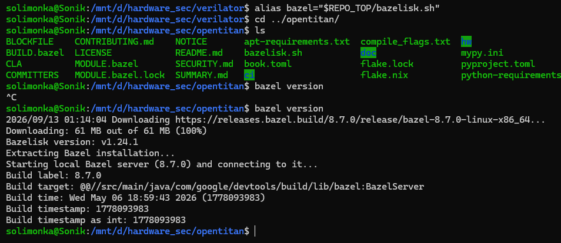

## Этап 6. Первый запуск теста (ошибка)

**19)** `bazel test --test_output=streamed //sw/device/tests:uart_smoketest_sim_verilator`

Запускаем UART smoke-тест на Verilator — базовая проверка всей цепочки Bazel → FuseSoC → Verilator.

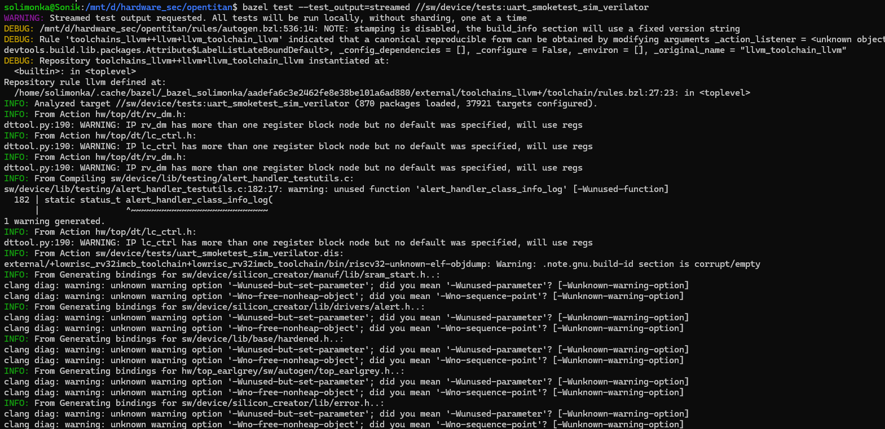

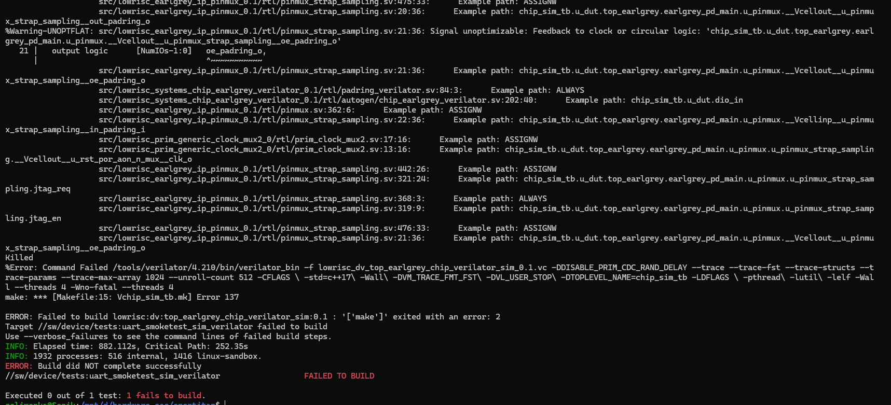

Сборка падает с ошибкой "make: ... Error 137" (FAILED TO BUILD). Код 137 означает, что процесс убили по сигналу SIGKILL, обычно это не хватило памяти.

## Этап 7. Решение проблемы с ресурсами

**20) Действие: создаём файл .wslconfig в каталоге пользователя Windows**

```
[wsl2]
memory=14GB
processors=12
swap=14GB
```

Раздаём WSL больше памяти, ядер и swap — сборке Verilator нужно минимум 7 ГиБ ОЗУ.

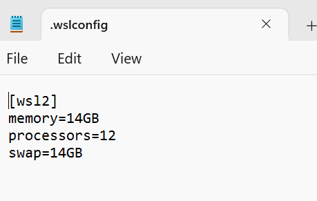

**21)** `wsl --shutdown; wsl ubuntu-22.04; nproc; free -h`

Перезапускаем WSL, чтобы настройки применились, и проверяем: nproc = 12, памяти около 13 ГиБ.

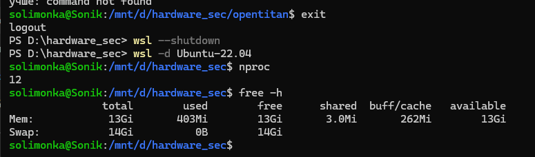

## Этап 8. Повторный запуск теста (успех)

**22)** `bazel test --test_output=streamed //sw/device/tests:uart_smoketest_sim_verilator`

Запускаем тот же тест ещё раз и теперь всё проходит успешно.

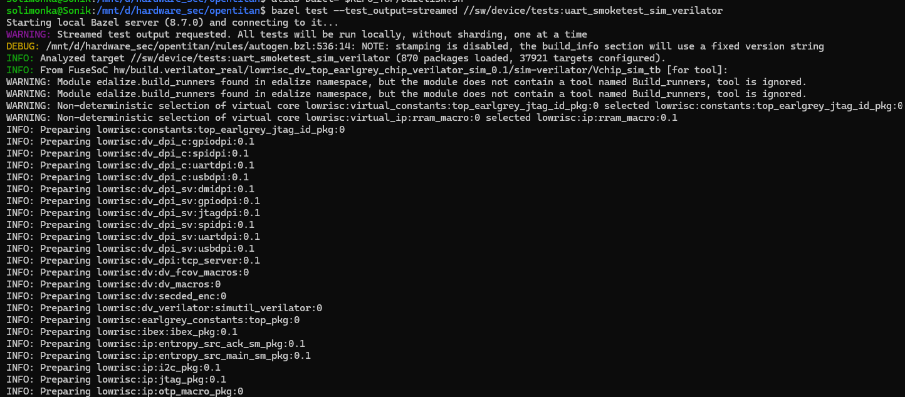

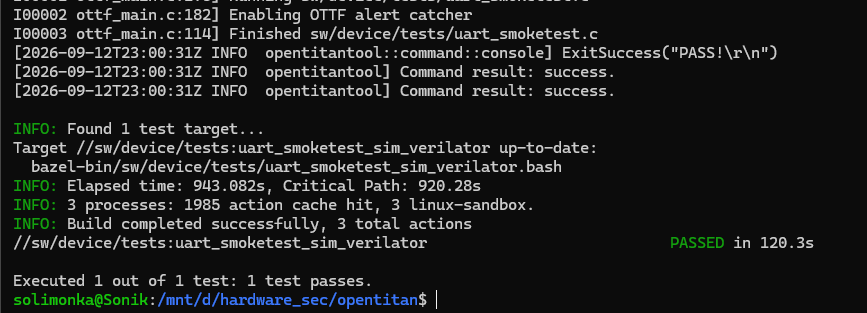

## Этап 9. Просмотр доступных тестов

**23)** `bazel query 'attr(tags, verilator, tests(//sw/device/tests/...))'`

Смотрим, какие готовые тесты можно запускать на Verilator.

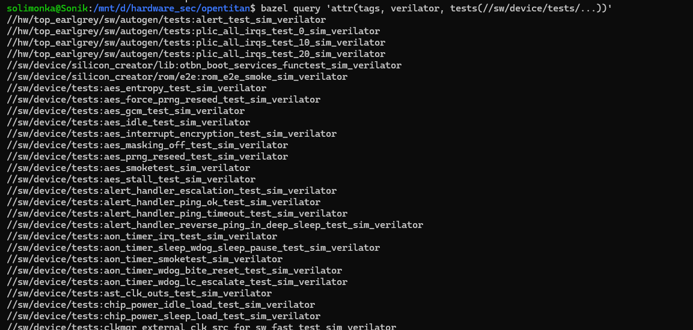

## Этап 10. Написание собственного теста

**24)** `nano sw/device/tests/hello_freertos.c`

Пишем свой тест: в функции test_main() выводим "Hello World!" и "Hello from OpenTitan FreeRTOS test!".

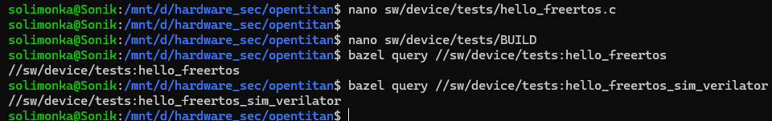

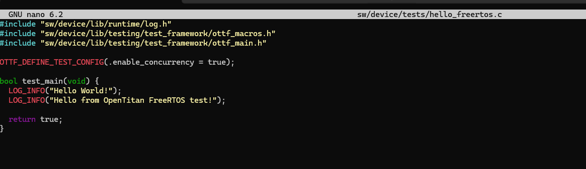

## Этап 11. Добавление теста в систему сборки

**25)** `nano sw/device/tests/BUILD`

Регистрируем тест в BUILD: имя hello_freertos, файл hello_freertos.c и зависимости.


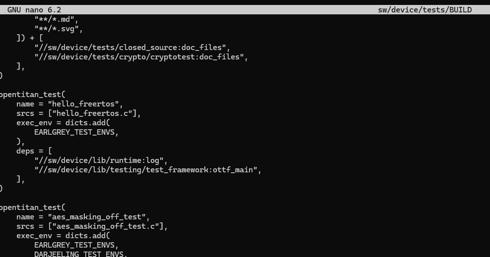

## Этап 12. Проверка, что тест определяется

**26)** `bazel query //sw/device/tests:hello_freertos`

Проверяем, что Bazel теперь видит наш тест.


## Этап 13. Сборка и запуск собственного теста

**27)** `bazel build //sw/device/tests:hello_freertos_sim_verilator`

Собираем тест.

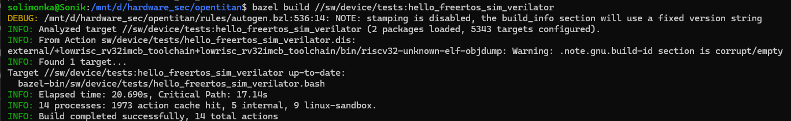

**28)** `bazel run //sw/device/tests:hello_freertos_sim_verilator`

Запускаем собранный тест на симуляторе.

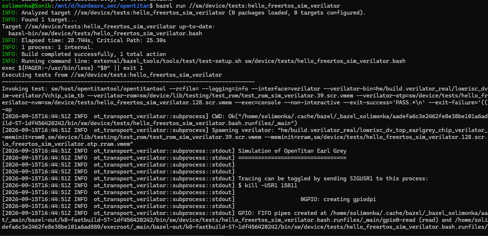

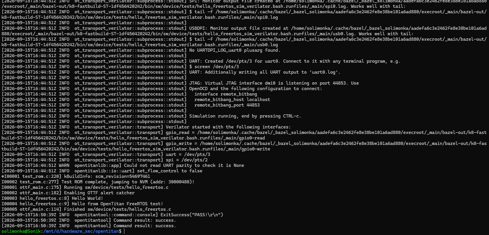

В UART-выводе появляются "Hello World!" и "Hello from OpenTitan FreeRTOS test!", тест проходит (PASS).

В итоге мы получили полностью настроенное окружение (OpenTitan + Verilator + Bazel), прошли штатный UART smoke-тест и написали собственный тест с выводом "Hello World!".
